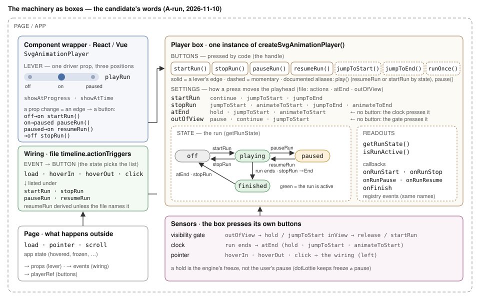
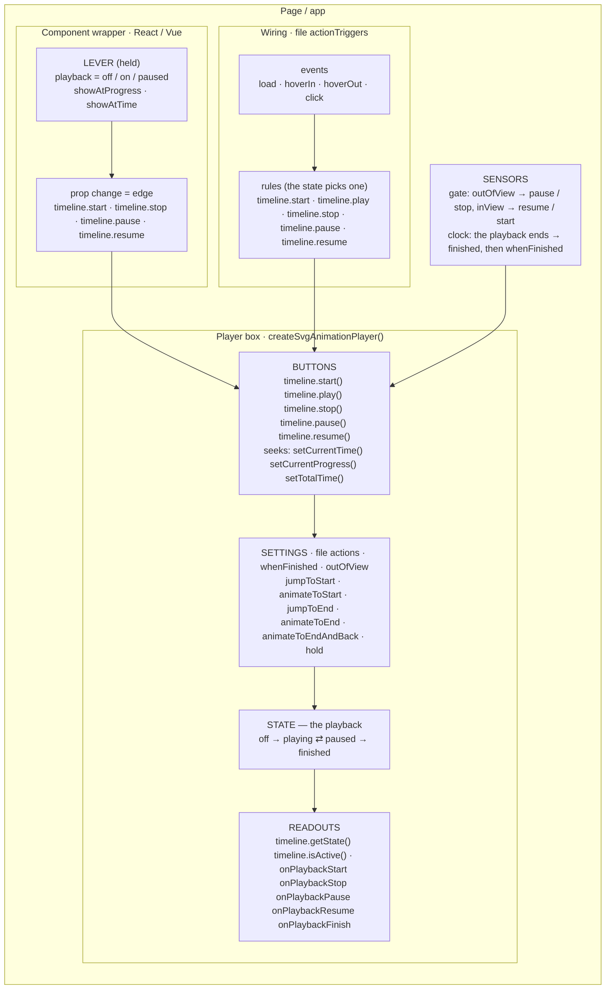
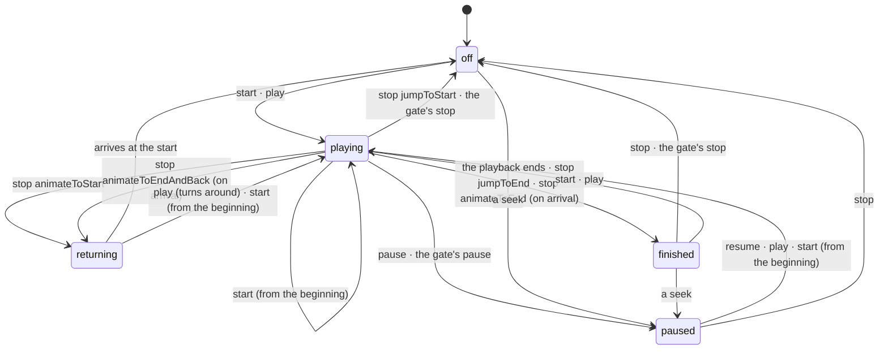

# Animation state — the playback model

Status: **implemented** — schema 1.24 (the model, 2026-11-11), 1.25 (the words, 2026-11-12), 1.26 (state words and move
words, 2026-11-13), 1.27 (variables, 2026-11-14) and 1.28 (the scroll timeline, 2026-11-14 — amended twice: the
`timeline.*` names and rules on elements, 2026-11-15; several timelines, states and state machines, 2026-11-20). The noun is
**playback** ([animation-state.playback-noun.md](./animation-state.playback-noun.md)); the handle is one object
`player.timeline.*` and the file names each built-in action `"timeline.start"` … (`player.timeline.*` and
`"timeline.start"` in 1.25 – 1.27, [animation-state.playback-namespace.md](./animation-state.playback-namespace.md)). 1.26
made `start` always play from the start, added `play` (start or carry on), kept the state apart from the picture
(`whenFinished`), let the gate press the real buttons and turned `jumpToStart()` / `jumpToEnd()` / `playOnce()` into seeks
and a recipe ([animation-state.feedback.2026-11-12.md](./animation-state.feedback.2026-11-12.md)). 1.24 spelt the noun
"run" (§9). Since then: 1.27 added **variables** — values beside the playback, which change the picture and never the state
(§3.5); 1.28 put the **scroll timeline** in plain words (§3.4 B, §6), and then gave a file **several timelines**,
**states** and **state machines** (§3.6, §7). More cases are in §3.1–3.6; what became of the options for named parts and
several animations is in §7. The
library survey is in [animation-state.survey.2026-11-09.md](./animation-state.survey.2026-11-09.md). Refines layer 2 of
[playback-layers.md](./playback-layers.md#layer-2--states-and-rules).

## 1. Terms and concepts

| Term | What it is | In the code |
|---|---|---|
| **Player box** | one instance of `createSvgAnimationPlayer()`: the animation, its clock, its state machine and its **imperative function controls** (buttons) | `PxAnimationPlayerApi` |
| **Button** | a momentary control on the box, pressed by code or by a rule: an act, named by a verb (+ the noun it acts on) — `timeline.start()` `timeline.play()` `timeline.stop()` `timeline.pause()` `timeline.resume()` | `player.timeline`, `PxPlayExecutor` |
| **Seek** | moves the playhead: `setCurrentTime()` · `setCurrentProgress()` · `setTotalTime()`. While `playing` it keeps playing from there; in any other state the playback becomes `paused` at that frame (1.26). A seek reports nothing | `PxPlayExecutor.seek` |
| **Component wrapper** | the React / Vue box around the player box: declarative, so it has **state controls** (levers), not buttons; a prop change is an edge that presses a button | `SvgAnimationPlayer`, `resolveDeclarativePlayback` |
| **Lever** | a held position (a prop), named by its noun and its positions; each lever has exactly two buttons — its edges | props |
| **Driver** | what makes the animation play: the file's wiring (the default, no prop; `actionTriggers` gives other wiring, `disableActionTriggers` switches it off so code drives), the lever (`playback`) or nothing (`showAtProgress` / `showAtTime` shows one frame, `showAsStatic` the picture as drawn). One driver family per element | `PxControlProps` union, `resolveControlMode` |
| **Playback** | one instance (session) of the animation being in effect — what lever 1 switches on. It begins with `timeline.start` (always from the start) or `timeline.play` (from rest), and lasts until `timeline.stop` retires it. While it exists its state is **`playing` · `paused` · `finished`**. A playback contains the iterations: a loop's playback is endless, `getTotalDuration()` is one playback's length | `PxPlayExecutor`, `getTotalDuration()` |
| **Off** | no playback; the rest pose shows (`whenIdle: static` / `firstFrame`) | `PxPlaybackState.off` |
| **Freeze** (lever 2) | the clock stopped inside a playback, pose kept, resumable — `timeline.pause` / `timeline.resume`; state `paused` | executor `paused` flag |
| **Finished** | a playback that reached its end by playing, or a stop that went to the end. The state stays `finished` whatever the picture then shows (`whenFinished`, 1.26); `timeline.stop` acts on it, `timeline.start` is a fresh playback | `PxPlaybackState.finished`, executor `finished` flag |
| **The end** (of the pass) | always a compound word — `jumpToEnd` · `animateToEnd` · `animateToEndAndBack` · `whenFinished` — never a bare verb; the end of the CURRENT pass | `onNaturalFinish` |
| **State word** | changes the playback state: `start` · `play` · `stop` · `pause` · `resume` (and the gate's `stop`) | the buttons |
| **Move word** (setting) | changes only the picture — where it goes and how: `jumpToStart` · `animateToStart` · `jumpToEnd` · `animateToEnd` · `animateToEndAndBack` · `hold` | `actions["timeline.stop"]`, `whenFinished` |
| **Wiring** | the file's rules for which page event presses which button: `actionTriggers: [{ action, event }]` — `timeline.start` · `timeline.play` · `timeline.stop` · `timeline.pause` · `timeline.resume` (and the state actions, §3.6); the current state picks the rule (the state rule, §4). A rule may be heard on an element of the picture (`element`), of the page (`selector`), for a key or a button (`with`) | `animator.actionTriggers`, `triggerActionFor` |
| **Sensor** | what the box notices by itself and answers by rule: the visibility gate (`inView` / `outOfView`), the clock reaching the end (`whenFinished`), pointer events (fed to the wiring). A sensor's rule is a setting, not a button | `PxVisibilityGate`, `onNaturalFinish` |
| **The gate's buttons** | out of view the gate presses the real `pause` (or a hard `stop` — at once, never animated); back in view it undoes only what it did (`resume`, or `start`). A playback the page paused stays paused (1.26; until 1.25 the gate held the engine's clock without telling) | `leaveView` / `returnToView` |
| **Return leg** | the picture moving back to the rest pose — after `timeline.stop: animateToStart` / `animateToEndAndBack` (state **`returning`**, no playback) or after `whenFinished: animateToStart` (state stays `finished`). `timeline.play()` turns it around; `timeline.start()` plays from the beginning | executor `reversed` |
| **Readout** | what the box reports: `timeline.getState()` (`off` · `playing` · `paused` · `finished` · `returning` · `destroyed`), `timeline.isActive()` (the playback exists), `isPlaying()` (= `playing`); callbacks `onPlaybackStart` `onPlaybackStop` `onPlaybackPause` `onPlaybackResume` `onPlaybackFinish`; registry events | `getState()`, callbacks, `PxAnimatorRegistry` |
| **Request vs result** | a lever asks (`playback="on"`), a readout answers (`playing` or `finished`); the words are kept apart on purpose | — |
| **Variable** (1.27) | a named, typed value the file declares (`definitions.variables`) and binds static values to — `"var(bg)"`, `"calc(var(size) / 2)"`. The page gives values from code (`variables`, `player.variables.set()`), by a named **variant**, or from its stylesheet (`cssVariables`). Not playback: a change never starts, seeks, pauses or restarts anything (§3.5) | `PxVariablesRuntime`, `PxVariablesApi` |
| **Predefined variable** | a value the player provides, named `player.…` — the pointer, the playback's clocks, the system's preferences: a sensor or a readout that the *file* can bind to | `player.pointer`, `player.timeline.iterationProgress`, `player.prefers.reducedMotion` |
| **Timeline** (1.28) | one clock of the file: a window of the keyframes with its own length, loop and speed — `animator.timelines: [ … ]`; the first is the default and needs no `id`. A timeline that no state uses plays by itself | `PxTimeline`, `player.getTimeline(id)` |
| **Track** | an attribute's keyframes on another timeline — `byTimeline: [{ timeline, keyframes }]`; the plain keyframes are the first timeline's | `PxTimelineTrack` |
| **State** (1.28) | a named part of ONE timeline (`timeline`, `inTime` – `outTime`) that overrides it while it is current: its passes, speed, direction, `whenFinished` (a picture word, or an action: go to a state, the next, the previous) and `whenLeaving` | `PxState`, `player.state` |
| **State machine** | a set of states of which exactly one is current; rules and `whenFinished` move it. Several run at once and do not know of each other; states that name none form one unnamed state machine | `PxStateMachine` |
| **Rule** | one entry of `actionTriggers`: an action, an event, what it acts on (`timeline`, `state`, `stateMachine`) and where it is heard (`element`, `selector`, `with`) | `PxActionTriggerRule` |

Four kinds of word, one grammar each:

| Kind | Holds / does | Named by | Example |
|---|---|---|---|
| **lever** | a position, held | the lever's noun + its positions | `playback="paused"` |
| **button** | an act that changes the state, momentary | a verb + the noun it acts on | `timeline.start`, `timeline.pause` |
| **setting** | how the picture moves | a move word — where + how | `animateToStart` |
| **readout** | what it is | a state word | `paused`, `finished` |

A lever has exactly two buttons (its edges); the file names buttons, never levers (a file cannot hold a position; the
page can); sensors press buttons by rule, and their rules (`whenFinished`, `actions.outOfView`) are settings, not buttons.

Variables (1.27) add a fifth kind, and it is not about the playback: a **value** — held, like a lever, but it changes
no state (§3.5).

States (1.28) are a lever the file itself holds: one current state per state machine. The buttons `state.goTo` ·
`state.next` · `state.previous` move it — in a rule, in `whenFinished` or from code — and the page holds it with the `state`
prop (§3.6).

## 2. The machinery as boxes





| Box | What it is | Its controls |
|---|---|---|
| **Player box** | one instance of `createSvgAnimationPlayer()` | buttons `timeline.start()` `timeline.play()` `timeline.stop()` `timeline.pause()` `timeline.resume()`; the seeks |
| **Settings** | how a press moves the picture | `actions["timeline.stop"]`; sensor rules `whenFinished` · `actions.outOfView`. The start has none: always from the start |
| **Wiring** | which page event presses which button | `actionTriggers` rules `{ action, event }` — `timeline.start` · `timeline.play` · `timeline.stop` · `timeline.pause` · `timeline.resume` over `load` · `hoverIn` · `hoverOut` · `click` · `pointerDown` / `pointerUp` · `keyDown` / `keyUp`; on an element (`element`), a page element (`selector`), a key or a button (`with`); the current state picks the rule |
| **Component wrapper** | React / Vue around the box — at most one driver prop | none (the file's wiring) · `actionTriggers` (other wiring) · `disableActionTriggers` (no wiring: code) · `playback` (the lever) · `showAtProgress` / `showAtTime` (one frame) · `showAsStatic` (the picture as drawn) |
| **Sensors** | what the box notices and answers by rule | the visibility gate (`inView` / `outOfView` — the real pause or stop), the clock reaching the end, pointer events (fed to the wiring) |
| **Inside** | the playback's state machine | `off` · `playing` · `paused` · `finished` · `returning` (· `destroyed`) |
| **Readouts** | what the box reports | `timeline.getState()` `timeline.isActive()` `isPlaying()`; `onReady` `onPlaybackStart` `onPlaybackStop` `onPlaybackPause` `onPlaybackResume` `onPlaybackFinish` `onDestroy`; registry events |
| **Variables** (1.27) | named values beside the machinery — they change what is drawn, never the state; not in the two drawings above | options / props `variables` · `variant` · `cssVariables`; `player.variables.set()` `setVariables()` `reset()` `setVariant()`; the player's own `player.…` values |
| **States** (1.28) | named parts of the timelines, one current per state machine; not in the two drawings above | `player.state.goTo()` `next()` `previous()` `get()` `getAll()`; the `state` prop; `onStateChange`; rules `state.goTo` · `state.next` · `state.previous`; `player.getTimeline(id)` for one timeline |

## 3. The model

```js
// WEB PLAYER — plays the way the file was saved: its actionTriggers drive it
const player = createSvgAnimationPlayer({
  container, document: 'lid.svga.json',     // a URL, or the document itself
                                            // disableActionTriggers: true → only the calls below
  onPlaybackStart() {}, onPlaybackStop() {}, onPlaybackPause() {}, onPlaybackResume() {}, onPlaybackFinish() {},
});

// lever 1 — the playback
player.timeline.start();    // a playback from the start — in every state
player.timeline.play();     // start or carry on: resumes a pause, turns a return around, nothing while playing
player.timeline.stop();     // → off per actions["timeline.stop"] (jumpToStart · animateToStart · …ToEnd → finished)
// lever 2 — the freeze (only inside a playback)
player.timeline.pause();
player.timeline.resume();
// seeks — while playing it keeps playing; otherwise paused at that frame
player.timeline.setCurrentProgress(1.2);   // progress counts iterations: 20 % into the second
player.timeline.setTotalTime(0);
// readouts
player.timeline.getState();    // 'off' | 'playing' | 'paused' | 'finished' | 'returning'
player.timeline.isActive();    // playing · paused · finished

// one pass of a looping file: timelineOptions: { iterations: 1 } + timeline.start() (playOnce() until 1.25)
```

```jsx
// REACT / VUE — one driver family per element
<SvgAnimationPlayer document={doc} />                                                      // the file's triggers (no prop)
<SvgAnimationPlayer document={doc} playback={hovered ? (frozen ? "paused" : "on") : "off"} />  // the lever
<SvgAnimationPlayer document={doc} showAtProgress={0.5} />                                 // one frame, nothing plays
<SvgAnimationPlayer document={doc} showAsStatic />                                         // the picture as drawn, calls ignored
// prop diff → button:  off→on timeline.start() · on→paused timeline.pause() · paused→on timeline.resume() · →off timeline.stop()
// a mount with playback="off" presses nothing; a mount with "paused" = timeline.start() + timeline.pause()
```

```json
// SCHEMA — rules name the buttons; a timeline's actions say how the stop moves the picture
"animator": {
  "timelines": [{ "actions": { "timeline.stop": "animateToEndAndBack", "outOfView": "stop" }, "whenFinished": "hold" }],
  "actionTriggers": [{ "action": "timeline.start", "event": "load" }]                                     // autoplay
}
// other wiring — each a list of rules:
//   the lid             [{ "action": "timeline.play", "event": "hoverIn" }, { "action": "timeline.stop", "event": "hoverOut" }]
//   a click play/pause  [{ "action": "timeline.play", "event": "click" }, { "action": "timeline.pause", "event": "click" }]
//   a restart toggle    [{ "action": "timeline.start", "event": "click" }, { "action": "timeline.stop", "event": "click" }]
```

| Where | Words |
|---|---|
| Props | `playback="off" \| "on" \| "paused"` beside `actionTriggers`, `disableActionTriggers`, `showAtProgress`, `showAtTime`, `showAsStatic` — one driver family at a time (the TypeScript union stays); none of them: the file's triggers |
| Handle | everything on `player.timeline`: `start()` `play()` `stop()` `pause()` `resume()`; the seeks; `getState()` `isActive()` `isPlaying()`; both clocks and the speed |
| File | `timelines: [{ … }]`, each with `actions: { "timeline.stop": jumpToStart · animateToStart · jumpToEnd · animateToEnd · animateToEndAndBack, outOfView: pause · continue · stop }` and `whenFinished: hold · jumpToStart · animateToStart`; `actionTriggers: [{ action, event, … }]` at the animator's root, one rule per event — `timeline.start` · `timeline.play` · `timeline.stop` · `timeline.pause` · `timeline.resume` |
| Readouts | `timeline.getState()` → `off` · `playing` · `paused` · `finished` · `returning` (the request says `on`, the result says `playing` or `finished`); `timeline.isActive()`; callbacks `onPlaybackStart` `onPlaybackStop` `onPlaybackPause` `onPlaybackResume` `onPlaybackFinish` |
| Editor | Start playback on · Play on · Stop playback on · Pause playback on · Resume playback on; Stop playback · When finished · Out-of-View Action |
| Variables (1.27) | options and props `variables` · `variant` · `cssVariables`, beside any driver; the handle `player.variables`; in the file `definitions.variables` · `definitions.variableVariants` · `"var(name)"` · `"calc(…)"` — §3.5 |
| States (1.28) | in the file `animator.states` · `animator.stateMachines` · rules `state.goTo` · `state.next` · `state.previous` · `byTimeline`; the handle `player.state`, `player.getTimeline(id)`; the prop `state`, the callback `onStateChange` — §3.6 |

Rules, written once:

- `playback` off → on presses `timeline.start()`, on → paused `timeline.pause()`, paused → on `timeline.resume()`, anything → off
  `timeline.stop()` (which clears the freeze).
- `timeline.start()` always plays from the start — in every state; the delay is waited again. `timeline.play()` carries on
  instead: a pause resumes, a return turns around, nothing while playing, otherwise a start.
- `timeline.stop()` retires per `actions["timeline.stop"]`; a stop to the end rests `finished`, and `whenFinished` applies.
- The state stays `finished` after the end whatever `whenFinished` shows — only the picture moves.
- A seek while `playing` keeps playing; in any other state the playback becomes `paused` there.

What 1.24 fixed (read from the source on 2026-11-10, schema 1.23):

1. The levers' edges had no buttons of their own — both edges of `play` and the OFF edge of `pause` landed on `play()`,
   which decided by state.
2. `play` was a lever named like a button and like the readout `playing`.
3. `pause` was a lever AND a button with one spelling.
4. `finish` sat in `actions` beside the buttons, but nobody presses it — the clock's rule.
5. One act, five spellings across the layers (`start` · `play()` · `PxTriggerAction.play` · gate `start` · `onPlay`).
6. Two booleans allowed an invalid pair (`play={false} pause={true}`); one three-position lever cannot.

What 1.26 fixed (the owner's review, 2026-11-12):

1. `start` meant three things by a setting in the file — now it means one, and `play` names the other.
2. The state followed the picture: `atEnd: jumpToStart` made a finished playback read `off`.
3. The gate held the clock in secret: the state said `playing` off screen, and no callback told the page.
4. `jumpToStart()` / `jumpToEnd()` were a stop and a finish in disguise, `playOnce()` a second start.
5. "Finish the pass, then go back" could not be written without changing what the natural end does.

Precedent for the quartet: `MediaRecorder` — `start()` `pause()` `resume()` `stop()`, `state: inactive · recording ·
paused`, events `start` `pause` `resume` `stop`. For the two levers: Three.js `AnimationAction.enabled` + `paused`
(`isRunning()` derived; `clampWhenFinished` = our `hold`). For `play` as start-or-carry-on: every media element.

Marks in §3.1–3.6 and §7: ✅ works today · 🧪 in the player, but marked "in development" · 💡 a sketch, not implemented.

### 3.1 More cases — the web player

✅ All of these work (written in the 1.28 words).

```js
// A play / pause button
button.onclick = () => player.timeline.getState() === 'playing' ? player.timeline.pause() : player.timeline.play();

// A replay button — from the start, in every state
replay.onclick = () => player.timeline.start();

// The lid from code: opens on enter, closes backwards on leave (the file's own triggers off)
const lid = createSvgAnimationPlayer({ container, document: lidDoc, disableActionTriggers: true,
  actions: { 'timeline.stop': 'animateToStart' } });
card.onpointerenter = () => lid.timeline.play();     // play, not start: it turns a closing lid around
card.onpointerleave = () => lid.timeline.stop();

// A spinner: loops while saving, then finishes its turn and rests
const spinner = createSvgAnimationPlayer({ container, document: spinnerDoc, disableActionTriggers: true,
  timelineOptions: { iterations: 'infinite' }, actions: { 'timeline.stop': 'animateToEnd' } });
spinner.timeline.start();
await save();
spinner.timeline.stop();                             // the current turn plays out → finished

// A slider: a seek outside `playing` leaves it paused on that frame
slider.oninput = () => player.timeline.setCurrentProgress(slider.valueAsNumber);   // 0..1 = one pass
playButton.onclick = () => player.timeline.play();                                 // carries on from there

// One pass of a looping file
createSvgAnimationPlayer({ container, document: loopDoc, timelineOptions: { iterations: 1 } }).timeline.start();

// A chain: B starts when A has played to its end
const a = createSvgAnimationPlayer({ container: elA, document: docA, onPlaybackFinish: () => b.timeline.start() });

// Twice as fast
player.timeline.setSpeed(2);

// The page gives the triggers (they replace the file's)
createSvgAnimationPlayer({ container, document: doc,
  actionTriggers: [{ action: 'timeline.play', event: 'click' }, { action: 'timeline.pause', event: 'click' }] });

// A still — the picture as drawn; playback calls are ignored with a warning (PX1506)
createSvgAnimationPlayer({ container, document: doc, showAsStatic: true });
```

```html
<!-- No code of your own: a tag, and the file's own triggers -->
<div data-px-document="/ball.json"></div>
<script>Pixodesk.SvgAnimator.createSvgAnimationPlayersFromPage();</script>
```

### 3.2 More cases — React and Vue

✅ All of these work (written in the 1.28 words).

```jsx
// Plays while a flag holds
<SvgAnimationPlayer document={spinner} playback={saving ? 'on' : 'off'} timelineOptions={{ iterations: 'infinite' }} />

// A play / pause button from state
<SvgAnimationPlayer document={doc} playback={playing ? 'on' : 'paused'} />
<button onClick={() => setPlaying(!playing)}>{playing ? 'Pause' : 'Play'}</button>

// The lid: the lever, and a stop that plays backwards (a hover back starts over — off → on is start)
<SvgAnimationPlayer document={lid} playback={hovered ? 'on' : 'off'} actions={{ 'timeline.stop': 'animateToStart' }} />

// Buttons through the ref — the file's triggers off, so only the code plays it
const playerRef = useRef(null);
<SvgAnimationPlayer document={bell} disableActionTriggers playerRef={playerRef} />
<button onClick={() => playerRef.current.timeline.start()}>Ring</button>

// Know when it has played
<SvgAnimationPlayer document={intro} playback="on" onPlaybackFinish={() => setIntroDone(true)} />

// One frame from app state: a progress ring, a rating, a step
<SvgAnimationPlayer document={ring} showAtProgress={uploaded / total} />

// The file's triggers, corrected by the page
<SvgAnimationPlayer document={doc} timelineOptions={{ iterations: 1, whenFinished: 'jumpToStart' }} />
<SvgAnimationPlayer document={doc} actionTriggers={[{ action: 'timeline.start', event: 'click' }]} />   // instead of the file's
```

```vue
<!-- Vue: the same props; the callbacks are events -->
<SvgAnimationPlayer :document="doc" :playback="hovered ? 'on' : 'off'" @playback-finish="onDone" />
```

### 3.3 More cases — the file

✅ All of these work (written in the 1.28 words: the timeline is the first of `timelines`, the wiring a list of rules at
the animator's root). The first eight are the editor's presets (its three hover presets also write
`"actions": { "outOfView": "continue" }`).

```json
// Loop when seen
"timelines": [{ "iterations": "infinite" }], "actionTriggers": [{ "action": "timeline.start", "event": "load" }]

// Play once when seen, hold the last frame
"timelines": [{}], "actionTriggers": [{ "action": "timeline.start", "event": "load" }]

// Replay each time seen
"timelines": [{ "actions": { "outOfView": "stop" } }], "actionTriggers": [{ "action": "timeline.start", "event": "load" }]

// Run always, even off screen
"timelines": [{ "iterations": "infinite", "actions": { "outOfView": "continue" } }],
"actionTriggers": [{ "action": "timeline.start", "event": "load" }]

// Hover: play / pause
"timelines": [{ "iterations": "infinite" }],
"actionTriggers": [{ "action": "timeline.play", "event": "hoverIn" }, { "action": "timeline.pause", "event": "hoverOut" }]

// Hover: there and back, by itself
"timelines": [{ "whenFinished": "animateToStart" }], "actionTriggers": [{ "action": "timeline.play", "event": "hoverIn" }]

// Hover: one nudge — every hover plays it from the start
"timelines": [{ "whenFinished": "jumpToStart" }], "actionTriggers": [{ "action": "timeline.start", "event": "hoverIn" }]

// Click: play / pause
"timelines": [{ "iterations": "infinite" }],
"actionTriggers": [{ "action": "timeline.play", "event": "click" }, { "action": "timeline.pause", "event": "click" }]

// The lid: opens while hovered, closes backwards
"timelines": [{ "actions": { "timeline.stop": "animateToStart" } }],
"actionTriggers": [{ "action": "timeline.play", "event": "hoverIn" }, { "action": "timeline.stop", "event": "hoverOut" }]

// A loop that ends politely: hover out finishes the pass, then goes back
"timelines": [{ "iterations": "infinite", "actions": { "timeline.stop": "animateToEndAndBack" } }],
"actionTriggers": [{ "action": "timeline.play", "event": "hoverIn" }, { "action": "timeline.stop", "event": "hoverOut" }]

// Starts half a second after it is fully in view
"timelines": [{ "delay": 500, "inViewThreshold": 1 }], "actionTriggers": [{ "action": "timeline.start", "event": "load" }]

// A click on one element of the picture, a button of the page, a key (1.28)
"actionTriggers": [{ "action": "timeline.start", "event": "click", "element": "#play" },
                   { "action": "timeline.pause", "event": "click", "selector": ".pause-button" },
                   { "action": "timeline.play", "event": "keyDown", "with": { "key": " " } }]

// Manual: no rules — the page's code or the `playback` prop plays it
"timelines": [{ "iterations": "infinite" }]
```

### 3.4 Cases — scroll

Scroll can drive an animation in three ways. The contract of the second one is §6.

| Way | What scrolling does | Status |
|---|---|---|
| **A. Play when seen** | starts the clock; out of view it pauses or stops | ✅ |
| **B. The file follows the scroll** | a timeline with `type: "scroll"` — the scroll position is the playhead (schema 1.28) | ✅ web player (so React and Vue) and the SVG + JS export; enabled in the editor; not React Native |
| **C. The page follows the scroll** | the page measures, then seeks | ✅ |

**A. Play when seen** ✅ — a clock timeline behind the visibility gate.

```json
// Plays when half of it has been on screen for 150 ms (the defaults, written out); pauses when scrolled away
"timelines": [{ "inViewThreshold": 0.5, "inViewDebounce": 150 }], "actionTriggers": [{ "action": "timeline.start", "event": "load" }]

// Plays again on every entry
"timelines": [{ "actions": { "outOfView": "stop" } }], "actionTriggers": [{ "action": "timeline.start", "event": "load" }]
```

**B. The file follows the scroll** ✅ — schema 1.28 (2026-11-14): one `type: "scroll"`, `follows` says what is
followed, `firstFrameWhen` / `lastFrameWhen` the two moments, `holdOnScreen` a held element. User docs:
`docs/library/playback-and-triggers.md`, "Following the scroll".

```json
// First frame as it appears at the bottom of the screen, last frame as it is gone at the top (the defaults)
"timelines": [{ "type": "scroll" }]

// Draws itself while it comes in: done once all of it is in
"timelines": [{ "type": "scroll", "lastFrameWhen": "fullyIn" }]

// A reading-progress bar: top of the page → bottom of the page
"timelines": [{ "type": "scroll", "follows": "pageScroll" }]

// Follows a horizontal scroller (the box around it)
"timelines": [{ "type": "scroll", "follows": "containerScroll", "axis": "horizontal" }]

// Scrollytelling: held in the centre for three screens while the section scrolls past, with a soft catch-up
"timelines": [{ "type": "scroll", "holdOnScreen": { "at": "center", "forScreens": 3 }, "smoothing": 150 }]

// Another element's way across the screen drives it (the element of the page: `pageDomElement`, 1.28 amended)
"timelines": [{ "type": "scroll", "follows": "pageDomElement", "selector": "#chapter-2" }]

// An exact place: the first frame when its top is 80 % down the screen
"timelines": [{ "type": "scroll", "firstFrameWhen": { "domElement": "top", "screen": 0.8 } }]

// Only a window of the keyframes, twice between the two moments
"timelines": [{ "type": "scroll", "inTime": 1000, "outTime": 3000, "iterations": 2 }]

// Beside a clock (1.28, 2026-11-20): a spinner plays on the first timeline, a card rises with the scroll on the second
"timelines": [{ "outTime": 2000, "iterations": "infinite" }, { "id": "reveal", "type": "scroll", "lastFrameWhen": "centered" }]
```

```js
// A scroll-driven file: create it, and that is all — no driver, no calls
const chart = createSvgAnimationPlayer({ container, document: '/chart.json' });

// A clock file made scroll-driven by the page (the file's clock-only keys are dropped, with a warning)
createSvgAnimationPlayer({ container, document: ballDoc,
  timelineOptions: { type: 'scroll', holdOnScreen: true } });

// The element itself instead of a selector
createSvgAnimationPlayer({ container, document: ballDoc,
  timelineOptions: { type: 'scroll', follows: document.querySelector('#chapter-2') } });

chart.timeline.getState();              // 'scrubbing' — on every engine, held or not
chart.timeline.getCurrentProgress();    // readouts work: where the scroll has put the playhead
chart.timeline.start();                 // buttons do nothing, and warn (PX1505)
chart.timeline.setCurrentProgress(0.5); // seeks do nothing either (PX1505): the scroll owns the playhead
```

```jsx
<SvgAnimationPlayer document={chart} />                                                      // a scroll-driven file
<SvgAnimationPlayer document={ball} timelineOptions={{ type: 'scroll', holdOnScreen: true }} />   // made so by the page
<SvgAnimationPlayer document={chart} timelineOptions={{ type: 'scroll', follows: chapterRef }} /> // a ref, not a selector
<SvgAnimationPlayer document={chart} timelineOptions={{ type: 'time' }} showAtProgress={p} />      // the page drives it: way C
```

**C. The page follows the scroll** ✅ — a clock file, the page's own measuring, a seek.

```js
// Any scroll maths → a seek. The state reads `paused`.
addEventListener('scroll', () => {
  const max = document.documentElement.scrollHeight - innerHeight;
  player.timeline.setCurrentProgress(scrollY / max);
}, { passive: true });
```

```jsx
// React, with any scroll hook (here Motion's)
const { scrollYProgress } = useScroll({ target: sectionRef });
const [progress, setProgress] = useState(0);
useMotionValueEvent(scrollYProgress, 'change', setProgress);
<SvgAnimationPlayer document={chart} showAtProgress={progress} />
```

**What scroll most likely gets next** 💡 — sketches, none of it exists. (Done in 1.28: the one `scrubbing` state; a
ref through `timelineOptions.follows`. Rejected: a `scroll={…}` prop of its own — `timelineOptions` already carries it.)

```js
createSvgAnimationPlayer({ container, document: '/chart.json',
  onScrollProgress(progress) {},                     // the playhead moved with the scroll
  onScrollStretchEnter() {}, onScrollStretchLeave() {},  // the first / last moment passed (either direction) — "before / between / after"
});
```

```html
<!-- The tag: scroll settings without code -->
<div data-px-document="/ball.json" data-px-scroll data-px-scroll-hold-on-screen></div>
```

```json
// Stops along the way: when the scrolling ends, the playhead settles on the nearest one
"timelines": [{ "type": "scroll", "snap": [0, 0.5, 1] }]

// Scroll as an input instead of a timeline type: the clock model stays, and the scroll position picks the state (§3.6)
"states": [{ "id": "intro", "outTime": 1000 }, { "id": "chart", "inTime": 1000, "outTime": 3000 }],
"scroll": { "follows": "parentDomElement", "enter": [{ "at": 0, "state": "intro" }, { "at": 0.4, "state": "chart" }] }
```

### 3.5 Cases — variables

✅ Schema 1.27 (2026-11-14). A file declares **variables** — named, typed values — and binds static values to them; the
page gives values while it runs. Variables sit **beside** the playback, not in it. The whole of it:
[docs/library/variables.md](../../docs/library/variables.md); the file side:
[docs/format/README.md](../../docs/format/README.md#variables).

```json
// THE FILE — declare, bind, and name sets of defaults (variants)
"animator": {
  "timelines": [{ "outTime": 1000, "iterations": "infinite" }],
  "actionTriggers": [{ "action": "timeline.start", "event": "load" }],
  "definitions": {
    "variables": {
      "bg":   { "type": "color",  "defaultValue": "#2a7fff" },
      "size": { "type": "number", "defaultValue": 40 } },
    "variableVariants": { "dark": { "bg": "#111827" } } } },
"children": [
  { "type": "circle", "cy": 100, "r": "var(size)", "fill": "var(bg)", "cx": "calc(var(size) + 10)" } ]
```

```js
// WEB PLAYER — a second handle, beside player.timeline
const player = createSvgAnimationPlayer({
  container, document: 'card.json',
  variables: { bg: '#ef4444' },              // applied before the first paint
  variant: 'dark',                           // a named set of defaults from the file
});
player.variables.set('size', 60);            // drawn on the next frame — the playback keeps its state and time
player.variables.setVariables({ bg: '#10b981', size: 48 });   // several, in one frame
player.variables.reset('bg');                // back to what the file says
player.variables.setVariant(null);           // back to the defaults
```

```jsx
// REACT / VUE — props, beside whichever driver is used
<SvgAnimationPlayer document={card} variables={{ bg: accent }} variant="dark" />
<SvgAnimationPlayer document={card} cssVariables />            // the stylesheet sets them: .card:hover { --bg: red; }
<SvgAnimationPlayer document={card} showAsStatic variables={{ bg: accent }} />   // nothing plays, the values still apply
```

```json
// THE PLAYER'S OWN VALUES — all named player.…; a file binds to them like to its own
{ "type": "rect", "height": 4, "width": "calc(var(player.timeline.iterationProgress) * 400)" }   // a progress bar
{ "type": "circle", "r": 20, "transform": { "translate": "var(player.pointer)" } }               // follows the pointer
```

Where variables meet the playback model:

| Meeting point | Rule |
|---|---|
| The kinds of word (§1) | a variable is a **value**: held like a lever, but it moves no state. `variables` · `variant` · `cssVariables` are not driver props — they go with any of them, `showAsStatic` included |
| Buttons and wiring | none. A variable presses no button, and no trigger sets one: a file cannot say "on click, set a variable" (§8) |
| Never the timeline | a change never starts, seeks, pauses or restarts the animation. An attribute is animated or bound, never both |
| Readouts as values | `player.timeline.currentTime` · `.currentProgress` · `.iterationProgress` are the playback's clocks, written on every frame while it plays — a file can draw its own progress with no keyframes |
| Sensors as values | `player.pointer` (`.x` `.y` `.over` `.down`) and `player.prefers.reducedMotion` · `.colorScheme`. The player listens only for what the file uses |
| A change that needs a rebuild | a variable bound to an effect's setting builds the player again: the playback's state, time and speed are kept, no playback callback fires, `load` triggers are not fired again. One limit: a rebuild while `finished` comes back `paused` at the last frame |
| Who wins | the page's stylesheet (with `cssVariables`) → your code → the declaration's `defaultSource` → the chosen variant → `defaultValue` |
| Not there yet | React Native has no `cssVariables` and does not feed the `player.…` values |

### 3.6 Cases — several timelines, states and state machines

✅ Schema 1.28, amended on 2026-11-20 (the segments of 2026-11-15 became states): the web player, React and Vue; React
Native plays the first timeline only. User docs: [docs/library/playback-and-triggers.md](../../docs/library/playback-and-triggers.md)
and [docs/format/README.md](../../docs/format/README.md).

The schema, as one type:

```ts
animator: {
  timelines?: Array<{                          // the first is the default; ids unique
    id?: string; name?: string;                // `id` — what states, rules and tracks call it; `name` — a label
    type?: 'time' | 'scroll';                  // + every key of a timeline, as before (§3.3, §3.4)
  }>;
  states?: Array<{                             // a part of ONE timeline; ids unique
    id: string; name?: string;
    stateMachine?: string;                     // none — the one unnamed state machine
    timeline?: string;                         // none — the first timeline
    inTime?: number; outTime?: number;         // none — the timeline's window
    initial?: boolean;                         // where its state machine starts; none ticked — the first of its states
    iterations?: number | 'infinite'; iterationDirection?: string; playbackSpeed?: number;   // none — the timeline's
    whenFinished?: 'hold' | 'jumpToStart' | 'animateToStart'
                 | { action: 'state.goTo'; state: string }
                 | { action: 'state.next' | 'state.previous'; stateMachine?: string };
    whenLeaving?: 'jump' | 'animateToEnd' | 'animateToStart';
  }>;
  stateMachines?: Array<{ id: string; name?: string }>;
  actionTriggers?: Array<{                     // one rule per event
    action: 'timeline.start' | 'timeline.play' | 'timeline.stop' | 'timeline.pause' | 'timeline.resume'
          | 'state.goTo' | 'state.next' | 'state.previous';
    event: 'load' | 'hoverIn' | 'hoverOut' | 'click' | 'pointerDown' | 'pointerUp' | 'keyDown' | 'keyUp';
    timeline?: string;                         // timeline.*: that timeline alone; none — the whole picture
    state?: string;                            // state.goTo
    stateMachine?: string;                     // state.next / state.previous; none — the unnamed one
    element?: string; selector?: string;       // heard on "#id" of the picture, or on a page element; none — the picture
    with?: { key?: string; code?: string; metaOrCtrlKey?: boolean; shiftKey?: boolean; altKey?: boolean;
             ctrlKey?: boolean; metaKey?: boolean; button?: number; pointerType?: 'mouse' | 'touch' | 'pen' };
  }>;
}
// an attribute — on a node, in definitions.animations, in an effect's parameter:
{ keyframes?: …;                                // the first timeline's
  byTimeline?: Array<{ timeline: string; keyframes?: …; value?: …; loop?: … }> }
```

```json
// Parts of one timeline: intro → loading (repeats until the page answers) → success or error, picked by page buttons
"timelines": [{ "outTime": 2900 }],
"states": [
  { "id": "intro",   "inTime": 0,    "outTime": 500,  "whenFinished": { "action": "state.next" } },
  { "id": "loading", "inTime": 500,  "outTime": 1500, "iterations": "infinite", "whenLeaving": "animateToEnd" },
  { "id": "success", "inTime": 1500, "outTime": 2200 },
  { "id": "error",   "inTime": 2210, "outTime": 2900 } ],
"actionTriggers": [
  { "action": "timeline.start", "event": "load" },
  { "action": "state.goTo", "state": "success", "event": "click", "selector": ".upload-done" },
  { "action": "state.goTo", "state": "error",   "event": "click", "selector": ".upload-failed" } ]

// Steps: arrow keys and page buttons
{ "action": "state.next",     "event": "keyDown", "with": { "key": "ArrowRight" } },
{ "action": "state.previous", "event": "click",   "selector": ".step-prev" }

// Two timelines that play by themselves, each its own length; hover pauses one of them
"timelines": [{ "id": "spin", "outTime": 1000, "iterations": "infinite" },
              { "id": "breathe", "outTime": 3000, "iterations": "infinite", "iterationDirection": "alternate" }],
"actionTriggers": [{ "action": "timeline.start", "event": "load" },
                   { "action": "timeline.pause", "timeline": "breathe", "event": "hoverIn" }]
// …an attribute rides "breathe" with a track:
{ "type": "circle", "r": 40,
  "animate": { "r": { "byTimeline": [{ "timeline": "breathe", "keyframes": [{ "time": 0, "value": 40 }, { "time": 3000, "value": 62 }] }] } } }

// A bell button: a shine that plays by itself (the first timeline), a pointer state machine over two timelines, and a
// second state machine for a new message
"timelines": [{ "outTime": 2400, "iterations": "infinite" }, { "id": "grow", "outTime": 200 },
              { "id": "dip", "outTime": 260 }, { "id": "ring", "outTime": 900 }],
"states": [
  { "id": "idle",    "timeline": "grow", "inTime": 0, "outTime": 0 },
  { "id": "hover",   "timeline": "grow" },
  { "id": "press",   "timeline": "dip", "whenFinished": { "action": "state.goTo", "state": "hover" } },
  { "id": "calm",    "stateMachine": "notice", "timeline": "ring", "inTime": 0, "outTime": 0 },
  { "id": "ringing", "stateMachine": "notice", "timeline": "ring" } ],
"stateMachines": [{ "id": "notice" }],
"actionTriggers": [
  { "action": "timeline.start", "event": "load" },
  { "action": "state.goTo", "state": "hover",   "event": "hoverIn",  "element": "#button" },
  { "action": "state.goTo", "state": "idle",    "event": "hoverOut", "element": "#button" },
  { "action": "state.goTo", "state": "press",   "event": "click",    "element": "#button" },
  { "action": "state.goTo", "state": "ringing", "event": "click",    "selector": ".new-message" } ]
```

```js
// WEB PLAYER — the states, and one timeline by its id
player.state.goTo('ringing');            // its state machine moves; the others do not
player.state.next('notice');             // next / previous: the named state machine, or the unnamed one
player.state.get();                      // ['idle', 'calm'] — one per state machine;  get('notice') → ['calm']
player.state.getAll();                   // every state id
player.getTimeline('breathe')?.pause();  // the same handle as player.timeline, for that timeline alone; an unknown id → undefined
player.timeline.pause();                 // the whole picture: every timeline
createSvgAnimationPlayer({ container, document: bell, onStateChange(state, previous, stateMachine) {} });
```

```jsx
// REACT / VUE — `state` is a lever: one id, or a list (one per state machine)
<SvgAnimationPlayer document={upload} state={done ? 'success' : 'loading'} onStateChange={setPart} />
<SvgAnimationPlayer document={bell} state={['hover', unread ? 'ringing' : 'calm']} />
```

```vue
<SvgAnimationPlayer :document="upload" :state="part" @state-change="onPart" />
```

How it plays:

| Point | Rule |
|---|---|
| A timeline no state uses | plays by itself — its own clock, loop and speed |
| A state machine | its current state plays its part of its timeline; on a state of another timeline, the attributes of the timeline it left show the node's own values |
| The rest pose | a timeline that plays by itself: its `whenIdle`; a state machine: the first frame of its starting state; an attribute on a timeline that is not showing: the node's own value |
| `player.timeline` | its buttons and speed act on the whole picture; its reads and seeks are of the first timeline |
| Playback callbacks | told once, for the first timeline; `onStateChange` by every state machine |
| A rule | `timeline.*` with no `timeline`: the whole picture; with one: that timeline; `state.goTo`: the state's state machine; `state.next` / `previous`: its `stateMachine`, else the unnamed one |
| A track that names the first timeline | is the first timeline's keyframes — it wins over the plain ones |
| A scroll timeline beside others | only it follows the scroll; nothing starts it; a state on it is not read |
| Mistakes | the first wins, and the player says which: PX1114 (a go-to naming no state), PX1115 (a repeated state id), PX1116 (a repeated timeline or state machine id, a reference to nothing, a timeline in two state machines, an attribute on two, keyframes beside `byTimeline`) |

Not there yet: React Native plays the first timeline only. The editor makes states, state machines and rules, but edits
one timeline so far, and warns when it opens a file with more.

## 4. Inside the box — the playback's state machine



| Point | Rule |
|---|---|
| The state rule — which list an event is read from | `playing`: pause · stop · start; `paused`: resume · play · stop · start; `off` and `returning`: start · play; `finished`: stop · start · play while it holds the last frame, otherwise start · play · stop. The first list that names the event wins |
| Arrival at the end | the natural end or a stop to the end: the playback is `finished`, then `whenFinished` moves the picture (hold · jumpToStart · animateToStart); `onPlaybackFinish` only for the natural end |
| "End" | the end of the CURRENT pass; a stop that finishes the pass reports `onPlaybackStop` on arrival |
| `paused` into `finished` | cleared: `start`, `play`, `stop` and the engine's end set the freeze off |
| The gate | out of view: `pause` pauses a playing playback; `stop` stops a playing or finished one at once (never animated, whatever the stop action says). In view: it resumes, or starts again — only what it did itself |
| Seeks | `playing` keeps playing; otherwise `paused` at that frame. Nothing is reported |
| Scroll timelines | `scrubbing`, always — none of the arrows above; §6 (the contract), §3.4 (cases) |
| Several timelines (1.28) | every timeline that plays by itself, and every state machine, has a playback of its own with these states — `player.getTimeline(id).getState()`; `player.timeline.getState()` reads the first timeline's |

## 5. Why these words

What each verb means elsewhere, in this grammar (GO = off → a playback · CONTINUE = unfreeze · FREEZE · RETIRE = to the
rest pose and stay · HALT = clock stopped, pose kept, no resume). Full matrix: the survey file.

| Word | Who | Meaning there |
|---|---|---|
| `play` | WAAPI, `<video>`, YouTube, lottie-web, dotLottie, Rive, GSAP, anime, Motion, SVGator, Godot | GO or CONTINUE by state — always "from the current position"; never a lever. Ours since 1.26: `timeline.play()`, the convenience, beside `start` (which always goes from the start) |
| `pause` | everyone but Spine / Unity's Animator (`timeScale` / `speed = 0`) | FREEZE, resumable — our `timeline.pause()` |
| `resume` | GSAP, anime, MediaRecorder | CONTINUE — where it differs from `play` |
| `stop` | lottie-web, dotLottie, SVGator, Three.js, Godot, Unity, Rive, YouTube, Motion | four different things: RETIRE to the first frame (lottie-web, dotLottie, SVGator, Three.js, Godot); HALT keeping the pose (Godot `stop(true)`, Motion — terminal); UNLOAD (YouTube); halt the state machine (Rive) — hence `timeline.stop` is pinned by the move word beside it |
| `start` / `stop` as a pair | MediaRecorder (`stop()` = the session is over, a new `start()` begins another), Android `MediaPlayer`, Unity `Animation` | a session's bracket — ours: `start` always begins a new one |
| `cancel` | WAAPI, Motion, anime | RETIRE (WAAPI → `idle`, Motion → initial) or HALT + dispose (anime) |
| `finish` · `complete` | WAAPI, anime, Motion | jump TO THE END, end callbacks run — ours: a seek to the end shows the frame; `onPlaybackFinish` reports a natural end |
| `restart` | GSAP, anime, SVGator | a fresh playback from the start — ours is `timeline.start` |
| `reset` | Three.js, anime, Rive | levers to default + time 0 (Three.js), pause + time 0 (anime), rebuild (Rive) — ours is `timeline.stop` (`jumpToStart`) |
| `freeze` / `unfreeze` | dotLottie (Rive `stopRendering`) | the render loop off / on — our gate presses the real `pause` instead (1.26) |
| `enabled` · `active` | Three.js, Unity, Godot `active` | the switch lever as a PROPERTY — never a method; our `playback` |
| `idle` · `inactive` · `unstarted` | WAAPI, MediaRecorder, YouTube | the not-playing state — our `off` |

Three.js in code, the two-lever precedent (`src/animation/AnimationAction.js`, verified):

```js
action.enabled = false;  // switch off: no impact, rest pose shows; time KEPT — re-enable continues
action.paused  = true;   // time stands still
action.isRunning();      // enabled && !paused && timeScale !== 0 && scheduled — derived, never set
if ( this.clampWhenFinished ) this.paused = true;   // the end of a one-shot: = our hold
else this.enabled = false;                          // = our whenFinished: jumpToStart
```

## 6. Scroll timelines

On a scroll timeline (a timeline with `type: "scroll"`, one type since 1.28 — `"view"` until 1.27) the scroll owns the
playhead: it is always on, and nothing starts, pauses, stops or finishes it. The contract as decided on 2026-11-14 (schema
1.28); how to set one up, and what it most likely gets next: §3.4.

| Part | On a scroll timeline |
|---|---|
| Readout `getState()` | `scrubbing`, on every engine — before the first moment, between the two and after the last, held or not; `isPlaying()` is false |
| Callbacks | none fire: a scroll timeline never starts and never finishes, so no `onPlaybackStart` … `onPlaybackFinish`, on any engine |
| Buttons | `start()` `play()` `stop()` `pause()` `resume()` `setSpeed()` `setDurationAtSpeed()` do nothing and warn (PX1505 `scrollOwnsPlayhead`) |
| Seeks | `setCurrentTime()` `setCurrentProgress()` `setTotalTime()` and the `showAtProgress` / `showAtTime` props do nothing and warn (PX1505) too; a page that wants to drive a scroll file makes it a clock timeline (`timelineOptions: { type: 'time' }`) |
| Reads | answer as usual: `getCurrentProgress()` is where the scroll has put the playhead |
| Wiring | inert — no rule reaches it: beside other timelines the whole picture's rules go to the clock ones; alone in a file, rules are warned about and skipped |
| Beside other timelines (1.28, 2026-11-20) | one of several: only it follows the scroll, the others keep their clocks; a state on it is not read (PX1116) |
| Settings | the scroll member of the schema has no `actions`, `whenFinished`, `whenIdle`, `playbackSpeed`, `delay`, `iterationDirection`, `frameRate` or gate numbers; it keeps `inTime` / `outTime`, a finite `iterations`, `engine` and its own keys (`follows`, `selector`, `firstFrameWhen`, `lastFrameWhen`, `holdOnScreen`, `axis`, `smoothing`) |
| Sensors | no visibility gate; the clock is the scroll position — the element's place in the layout, whatever moves it (a CSS transform counts only for the player's own measuring) |
| Page code | `timelineOptions.follows` also takes an element (web) or a React / Vue ref, in place of the word |
| Editor | the Timeline choice (Time · Scroll) is always offered |

Still open, for a later step: a named readout and events for "before / between / after" (GSAP's `onEnter` /
`onLeave`); whether scroll stays a timeline type or also becomes an input that drives progress (layer 4 of
[playback-layers.md](./playback-layers.md)), which decides how it combines with states.

## 7. Several parts, several animations — what was built

✅ Built in 1.28: segments (option B) on 2026-11-15; states, state machines and several timelines (B, part of C, and D) on
2026-11-20 — the cases are §3.6. What became of each option:

| Option | Became |
|---|---|
| A markers | the states: a named part (`inTime` – `outTime`) the page plays with `player.state.goTo(id)` |
| B segments | the states, with their own settings, `whenFinished` that goes on, `whenLeaving`, and the rules `state.goTo` · `state.next` · `state.previous` (built first as `timeline.segments`, 2026-11-15) |
| C states | state machines without inputs: rules and `whenFinished` move them; conditions on values wait (§8) |
| D timelines | `animator.timelines`, an attribute's tracks (`byTimeline`), `player.getTimeline(id)`; a state machine may use several timelines |
| Blending | not done — an attribute rides one timeline at a time |

The options as weighed on 2026-11-13 follow, in the words of that day (`player.playback`, `"playback.start"`, one
`timeline` object).

Background: item 13 of [animation-state.feedback.2026-11-12.md](./animation-state.feedback.2026-11-12.md) (Lottie markers,
dotLottie, Rive) and layers 2–4 of [playback-layers.md](./playback-layers.md).

The example in every option: one button animation with three parts — `intro` (0–1 s, once), `loop` (1–3.5 s, repeats),
`success` (3.5–5 s, once).

### 7.1 Today ✅ — the page does it

```jsx
// Two files, sequenced by the page
{introDone
  ? <SvgAnimationPlayer key="loop" document={loop} playback="on" timelineOptions={{ iterations: 'infinite' }} />
  : <SvgAnimationPlayer key="intro" document={intro} playback="on" onPlaybackFinish={() => setIntroDone(true)} />}
```

```js
// One file, one window per player
createSvgAnimationPlayer({ container, document: doc, timelineOptions: { inTime: 1000, outTime: 3500, iterations: 'infinite' } });
```

### 7.2 Option A — markers: the file names the parts, the page plays them

Like Lottie markers with `playSegments`. The file holds names only.

```json
"timeline": {
  "outTime": 5000,
  "segments": {
    "intro":   { "inTime": 0,    "outTime": 1000 },
    "loop":    { "inTime": 1000, "outTime": 3500 },
    "success": { "inTime": 3500, "outTime": 5000 }
  }
}
```

```js
player.playback.start('intro');                               // plays that part; `finished` at its end
player.playback.start('loop', { iterations: 'infinite' });
player.playback.getSegment();                                 // 'loop'
player.playback.getSegments();                                // ['intro', 'loop', 'success']

// intro → loop stays the page's job
const player = createSvgAnimationPlayer({ container, document: doc,
  onPlaybackFinish({ segment }) { if (segment === 'intro') player.playback.start('loop', { iterations: 'infinite' }); } });
```

```jsx
<SvgAnimationPlayer document={doc} playback="on" segment={saved ? 'success' : 'loop'} />
```

### 7.3 Option B — segments: each part has its settings and says what comes next

Option A, plus the timeline's own keys per segment, `next`, and buttons the file can wire.

```json
"timeline": {
  "segments": {
    "intro":   { "inTime": 0,    "outTime": 1000, "next": "loop" },
    "loop":    { "inTime": 1000, "outTime": 3500, "iterations": "infinite" },
    "success": { "inTime": 3500, "outTime": 5000, "whenFinished": "hold" }
  },
  "actionTriggers": { "playback.start": "load", "segment.set": { "success": "click" } },   // or "segment.next": "click"
  "actions": { "segment.set": "animateToEnd" }    // how a switch gets there: jump · animateToEnd · animateToStart
}
```

```js
player.segment.set('success');             // switches the way actions["segment.set"] says
player.segment.set('success', 'jump');     // or the call says how
player.segment.next();
player.segment.get();                      // 'loop'
player.segment.getAll();                   // ['intro', 'loop', 'success']

createSvgAnimationPlayer({ container, document: doc,
  onSegmentChange(segment, previous) {},   // intro → loop, loop → success
  onPlaybackFinish() {} });                // a segment with no `next` played to its end
```

```jsx
// `segment` is a lever, like `playback`: a held position; a change presses segment.set
<SvgAnimationPlayer document={doc} playback="on" segment={saved ? 'success' : 'loop'} onSegmentChange={setPart} />
```

### 7.4 Option C — states: a state machine in the file

Like Rive and dotLottie state machines. Option B, plus inputs the app sets and rules that move between states.

```json
"timeline": {
  "segments": { "idle": { "outTime": 2000 }, "walk": { "inTime": 2000, "outTime": 3000 }, "jump": { "inTime": 3000, "outTime": 3600 } },
  "inputs":   { "speed": 0, "jump": "event" },
  "states": {
    "idle": { "segment": "idle", "iterations": "infinite", "transitions": [{ "to": "walk", "when": { "speed": { "above": 0 } } }] },
    "walk": { "segment": "walk", "iterations": "infinite", "transitions": [{ "to": "idle", "when": { "speed": 0 } },
                                                                           { "to": "jump", "on": "jump" }] },
    "jump": { "segment": "jump", "transitions": [{ "to": "walk", "on": "finished" }] }
  },
  "actionTriggers": { "input.jump": "click" }
}
```

```js
player.inputs.set('speed', 1);     // idle → walk
player.inputs.fire('jump');        // walk → jump → walk
player.state.get();                // 'walk'
// onStateChange(state, previous)
```

```jsx
<SvgAnimationPlayer document={hero} inputs={{ speed }} onStateChange={setState} playerRef={playerRef} />
<button onClick={() => playerRef.current.inputs.fire('jump')}>Jump</button>
```

### 7.5 Option D — several timelines in one file

Like Rive's animations and layers. Each timeline has its own clock, triggers and playback, and they can run at once on
different elements.

```json
"animator": {
  "timelines": {
    "blink": { "iterations": "infinite", "actionTriggers": { "playback.start": "load" } },
    "wave":  { "actionTriggers": { "playback.start": "click" }, "whenFinished": "animateToStart" }
  },
  "bindings": [
    { "target": "#eyes", "animateWith": ["blinkKeys"], "timeline": "blink" },
    { "target": "#arm",  "animateWith": ["waveKeys"],  "timeline": "wave" }
  ]
}
```

```js
player.timeline('wave').playback.start();     // every timeline has the same handle as today
player.timeline('blink').playback.pause();
player.playback.start();                      // the first timeline — today's calls keep working
```

```jsx
<SvgAnimationPlayer document={mascot} playback={{ blink: 'on', wave: waving ? 'on' : 'off' }} />
```

### 7.6 Side by side

| | A markers | B segments | C states | D timelines |
|---|---|---|---|---|
| Play a named part from code | ✓ | ✓ | ✓ | ✓ |
| Intro → loop without page code | — | ✓ | ✓ | — |
| The file wires hover / click to a part | — | ✓ | ✓ | ✓ |
| Conditions, values from the app | — | — | ✓ | — |
| Two animations at once | — | — | — | ✓ |
| Blend from one into another | — | — | — | — |
| Who decides what plays | the page | the file, simple rules | the file, rules and inputs | the file, per timeline |
| New in the schema | `segments` (names) | + settings, `next`, `segment.*` | + `inputs`, `states` | `timelines`, a binding's `timeline` |
| New in the player | a window that changes while playing | + "segment ended", the switch rule | + evaluating rules | one executor per timeline |
| New in the editor | markers on the ruler | + a panel per segment | a state graph | a timeline switcher |
| Closest to | Lottie markers | dotLottie segments | Rive, dotLottie state machines | Rive animations and layers |

A, B and C build on each other: each is the one before plus one block, so a file written for A stays valid in B and C.
D is separate and combines with any of them. None of them blends two animations; that needs a different engine.

What today's words would mean once a file has segments:

| Word | With segments |
|---|---|
| `playback.start()` | the current segment from its start; `start('name')` a named one |
| `whenFinished` · `iterations` · `playbackSpeed` | per segment, the timeline's value as the default |
| `actions["playback.stop"]` | moves inside the current segment: its start, its end |
| `onPlaybackFinish` | a segment with no `next` ended; `onSegmentChange` reports the steps before it |
| `getDuration()` · progress | the current segment's length; progress counts its iterations |
| the visibility gate | unchanged |

**Suggestion:** B as the next schema step, released in two parts — first the names and `start('name')` (which is A), then
`next`, the per-segment settings and `segment.set`. C waits until a real file needs conditions. D only if two animations
at once becomes a real request.

## 8. Later — not in this step

- **Inputs (layer 2 + 4, the destination):** every lever and button becomes an input the file wires events to;
  `playback`'s positions are the built-in input. These names are those inputs, so this is a step, not a detour:
  ```json
  "timelines": [{ "state": { "playback": { "off": { "initial": true }, "playing": {}, "paused": {}, "finished": {} } }, "whenFinished": "hold" }],
  "actionTriggers": [{ "action": "timeline.play", "event": "hoverIn" }, { "action": "timeline.stop", "event": "hoverOut" }]
  ```
- **After the states (1.28):** conditions that read a variable (option C's inputs), a `transitions` list, a state that
  shows only some elements (slides), blending two animations, several timelines in React Native.
- **The gate as a sensed lever** (`inView`), with its own rule words beside `outOfView`.
- **Pointer words:** `hoverIn` / `hoverOut` are web words; Rive, dotLottie and React Native say `pointerEnter` /
  `pointerExit` (1.28 added `pointerDown` / `pointerUp` and `keyDown` / `keyUp`).
- **Rules that set or read a variable:** variables (1.27) carry values from the page. A trigger that sets one, or a
  condition that reads one, is not designed.

## 9. History

- 2026-11-09: the two switches as `timeline.state.animation.{play, pause}` + `playOn` / `playOff` names; then the
  three tiers (controls · animation state · moves) and the library survey.
- 2026-11-10: the boxes; `start` / `stop` vs `play` / `resume` / `pause` ambiguity; `enable` / `disable`, `activate` /
  `deactivate`, one-go-button `play()`, nouned spellings tried; the run as the lever's noun; `playRun` as the one driver
  prop with the `play` family mark; `endRun` weighed against `stopRun` and not taken.
- 2026-11-11: the noun changed — **playback**, not run (first flat: `startPlayback()` · `onPlaybackStart` · the `playback` prop ·
  `getPlaybackState()` · `playOnce()`); the reasoning is in [animation-state.playback-noun.md](./animation-state.playback-noun.md).
- 2026-11-12: one home — `player.playback.*` (`start()` · `getState()` · `getSpeed()` · `…AtSpeed`), no `play()` / `pause()`
  aliases, and dotted action names in the file (`"playback.start"`), folded into schema 1.25
  ([animation-state.playback-namespace.md](./animation-state.playback-namespace.md)).
- 2026-11-13: schema 1.26, the owner's review ([animation-state.feedback.2026-11-12.md](./animation-state.feedback.2026-11-12.md)):
  `start` always from the start and `play` beside it; `whenFinished` (was `atEnd`), the state stays `finished`; `outOfView:
  stop`, the gate presses the real buttons; `animateToEndAndBack`; `onPlaybackFinish`; one `document` option and
  `playerActionTriggers`; `jumpToStart()` / `jumpToEnd()` / `playOnce()` removed; progress counts iterations. This text lost
  its two working sections (the change ledger, the rejected ideas — both in git history) and gained §6.
- 2026-11-13, later: more cases for the player, the components and the file (§3.1–3.3); the scroll cases, with what
  scroll most likely gets next (§3.4); the options for named parts, states and several timelines (§7).
- 2026-11-13, owner decision: a player plays the way the file was saved — no prop = the file's `actionTriggers` drive it
  on every surface; `playerActionTriggers` removed (no alias); `actionTriggers` (a whole block instead of the file's;
  `null` / `{}` = none), `disableActionTriggers` (manual), `showAsStatic` (the picture as drawn, playback calls ignored,
  PX1506); `actions` replaces the file's block (it merged). §2 and §3 updated; the 1.26 entry above keeps its words.
- 2026-11-14: schema 1.27 — variables: `definitions.variables` and `variableVariants`, `"var(name)"` and `"calc(…)"`
  in place of a static value, the handle `player.variables`, the options and props `variables` · `variant` ·
  `cssVariables`, and the player's own `player.…` values. They change the picture, never the playback.
- 2026-11-14: schema 1.28 — one scroll timeline in plain words (`follows`, `firstFrameWhen` / `lastFrameWhen`,
  `holdOnScreen`; `type: "view"` gone), the state `scrubbing` on every engine, no playback callbacks, seeks ignored
  like the buttons (PX1505); §3.4 B and §6 rewritten in the new words.
- 2026-11-15: this text caught up with 1.27 — variables added to §1, §2, §3 and §8, and the new §3.5.
- 2026-11-15: schema 1.28 amended — the `timeline.*` names (`player.timeline`, `"timeline.start"` …; the handle was
  `player.playback`), `actionTriggers` at the animator's root, an event on an element of the picture (`element`), of the
  page (`selector`), for a key or a button (`with`; `pointerDown` / `pointerUp` / `keyDown` / `keyUp`), the scroll words
  `thisDomElement` / `parentDomElement` / `pageDomElement` and `{ domElement, screen }`; `timeline.segments` — option B
  of §7, built.
- 2026-11-20: schema 1.28 amended again — `animator.timelines` (a list), the segments became `animator.states` with
  `stateMachines`, `actionTriggers` a list of rules, an action as an object in `whenFinished`, `byTimeline` on
  attributes, shared animations and effect parameters; `player.state`, `player.getTimeline(id)`, `onStateChange`, the
  `state` prop; PX1114 – PX1116. This text caught up: every example in the 1.28 words, §1 – §4 and §6 updated, the new
  §3.6, and §7 became what was built (its options kept as they were weighed).
