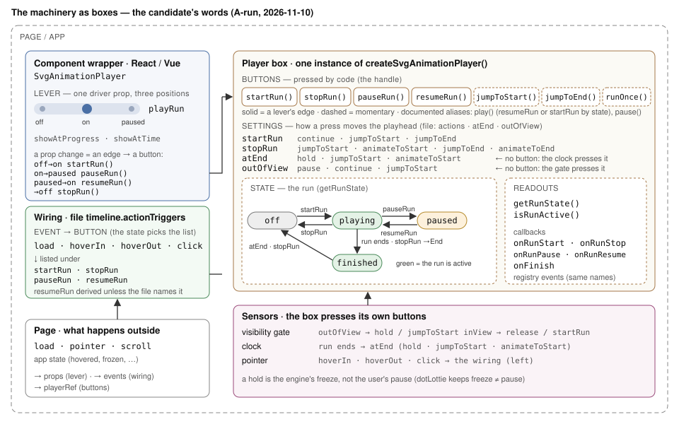
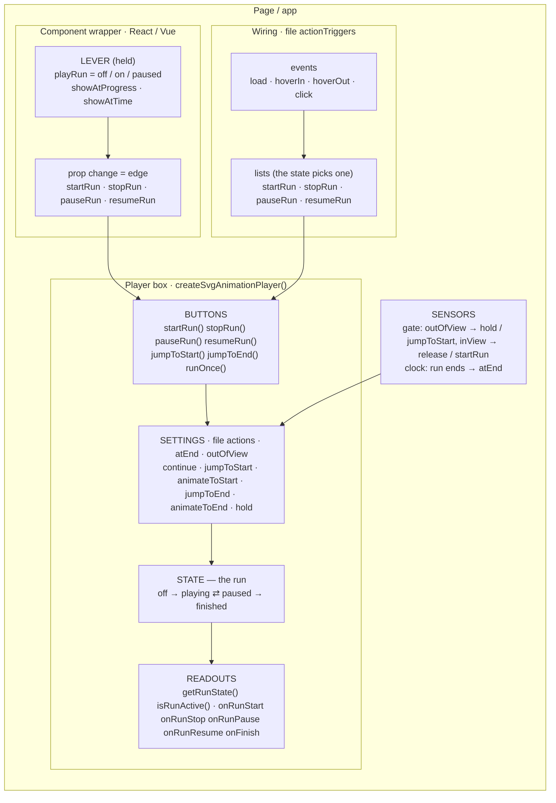
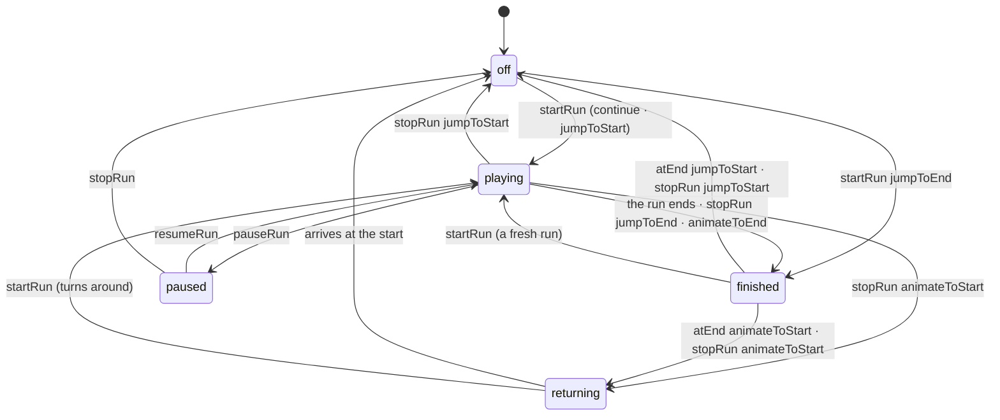

# Animation state — the run model

Status: **candidate A-run (2026-11-10), not decided.** The brainstorm of 2026-11-09/10 (the two switches, the tiers,
the naming rounds, the library survey) is folded into this text; what it rejected is in §6, the full survey is in
[animation-state.survey.2026-11-09.md](./animation-state.survey.2026-11-09.md). Refines layer 2 of
[playback-layers.md](./playback-layers.md#layer-2--states-and-rules). Schema 1.23; every "today" fact was read from the
source on 2026-11-10.

## 0. The change in one place

### OLD → NEW

| Where | Old | New |
|---|---|---|
| Props (React / Vue) | `play` · `pause` · `playState` (`idle` · `playing` · `paused`) | `playRun="off" \| "on" \| "paused"` — one driver prop, three positions |
| Handle | `play()` (start or resume by state) | `startRun()` — lever 1 on |
| Handle | `stop()` | `stopRun()` — lever 1 off (`endRun()` weighed and not taken, §6) |
| Handle | `pause()` | `pauseRun()` — lever 2 on (the noun on all four buttons: one family, `resumeRun` cannot be read as "start again", `onRunPause` is the user's pause) |
| Handle | `playOnce()` | `runOnce()` |
| Handle | `getPlayState()` → `idle` · `playing` · `paused` · `finished` · `destroyed` | `getRunState()` → `off` · `playing` · `paused` · `finished` · **`returning`** · `destroyed` |
| Registry events | `add` `remove` `play` `pause` `stop` `finish` | `add` `remove` `runStart` `runStop` `runPause` `runResume` `finish` |
| Callbacks + registry events | `onPlay` (fires for a start AND a resume) | `onRunStart` + `onRunResume` |
| Callbacks + registry events | `onStop` | `onRunStop` |
| Callbacks + registry events | `onPause` (fires for the user's pause AND the gate's engine hold) | `onRunPause` — the user's pause only; the gate's hold reports nothing (DECIDED 5) |
| File `actionTriggers` | `start` · `stop` · `pause` · `resume` | `startRun` · `stopRun` · `pauseRun` · `resumeRun` (`resumeRun` derived as `resume` is today) |
| File `actions` | `start` · `stop` | `startRun` · `stopRun` |
| File | `actions.finish` | `atEnd` — a timeline key beside `whenIdle` (a sensor rule, not a button) |
| Wire | 1.23 | 1.24, one step: the renames above, `up` / `down` exact |
| Editor labels | Start on · Stop on · Pause on · Resume on; Start Action · Stop Action | Start run on · Stop run on · Pause run on · Resume run on; Start run · Stop run · At end of pass |
| Internal | `PxPlayState` (`idle`), `PxDeclarativeAction.start/stop/pause/resume`, `PxTriggerAction.play`, `PxTriggerList`, executor `start/stop/pause/resume/play`, gate host `start` | `PxRunState` (`off`) and the public words (`startRun` / `stopRun` / `pauseRun` / `resumeRun`) |

### NEW

| What | Why |
|---|---|
| `resumeRun()` on the handle | lever 2's second button; today both edges land on `play()` |
| `play()` and `pause()` as documented one-line ALIASES — `play()` = `getRunState() === 'paused' ? resumeRun() : startRun()`, `pause()` = `pauseRun()` | the `<video>`-minded developer lands; the precise four stay the model; drop later if unused (easier than adding back) |
| `isRunActive()` | the region `playing` · `paused` · `finished` as one boolean |
| `onRunResume` callback + registry event | mirrors the button (MediaRecorder's event set) |
| the term **run** (§1) | the thing lever 1 switches on; `runOnce()`, `getRunState()`, `isRunActive()` hang off it |

### REMOVE

| What | Why |
|---|---|
| `play()` as THE button | kept only as the alias above; the model's buttons are the four |
| props `play` · `pause` · `playState` | folded into `playRun` |
| the "`pause` does nothing without `play`" warning and `playStateToLevels` | `playRun` has no invalid position pair |
| `actions.finish` as an action slot | nobody presses it; it is the clock's rule → `atEnd` |

### UNCHANGED

| Where | Stays as it is |
|---|---|
| Handle | `jumpToStart()` · `jumpToEnd()` · `destroy()` · `isPlaying()` · `isReady()`; every time / speed / progress read and write |
| Callbacks | `onReady` `onFinish` (not `onRunFinish` — WAAPI / `onEnded` expectations) `onDestroy` `onWarning` `onError` |
| Props | `playUsingActionTriggers`, `showAtProgress` / `showAtTime`; one driver family per element (the TypeScript union) |
| File | the `resume` derivation (now `resumeRun`); `actions.outOfView` (`pause` · `continue` · `jumpToStart`) and the gate numbers `inViewThreshold` / `inViewDebounce`; the preset words `continue` `jumpToStart` `animateToStart` `jumpToEnd` `animateToEnd` `hold`; `whenIdle` |
| Rules | the state rule (`triggerActionFor`), the visibility gate, PX1505 on scroll timelines, the registry |

### DECIDED 2026-11-10 (set to the leanings; revisit after the code review)

| # | Question | Decision |
|---|---|---|
| 1 | `play()`: drop or keep | kept, with `pause()`, as documented aliases (see NEW) |
| 2 | the noun on lever 2 | `pauseRun()` / `resumeRun()`, applied throughout |
| 3 | `actions.outOfView` → a timeline key beside `atEnd` | no — stays in `actions` (UNCHANGED) |
| 4 | the readout during a return leg (`stopRun: animateToStart`, `atEnd: animateToStart`) | a fifth state **`returning`** (SVGator `rollback`): the lever is off, the picture still moves; `isRunActive()` is false; `startRun()` turns it around |
| 5 | the gate's hold | reports nothing (no callback; `getRunState()` unchanged by a hold); documented; a `frozen` readout / `onFreeze` later |
| 6 | callback word order | noun first for events (`onRunStart`), verb first for methods (`startRun()`) |
| 7 | `restart()` on the handle | none — `startRun()` with `actions.startRun: jumpToStart`, or `jumpToStart(); startRun()` |
| 8 | readout shape | flat `getRunState()` + `isRunActive()`; no nesting |
| 9 | type name | `PxPlayState` → `PxRunState`; `PxStartBehavior` / `PxStopBehavior` / `PxFinishBehavior` → `PxStartRunBehavior` / `PxStopRunBehavior` / `PxAtEndBehavior` (names mirror the keys) |
| 10 | registry events | `add` `remove` `runStart` `runStop` `runPause` `runResume` `finish` |
| 11 | `isPlaying()` | stays (= `getRunState() === 'playing'`) |

### PLAN (recommendations, 2026-11-10)

Verdict of the review: a real improvement in correctness and consistency (the handle's missing lever edges, the invalid
prop pair, `play` as a lever word, `finish` among buttons, five spellings of one act, the user's pause vs the gate's
hold), paid for with unfamiliarity (every competitor says `play()` / `pause()`; React developers think `<video>`) and
churn (the third rename of the control props; wire 1.24; docs, cheat sheet, learning projects, ten videos).

1. **Do it now** — the defects are real and the window is cheap today; it closes as users arrive.
2. **Keep `play()` and `pause()` as documented one-line aliases** (`play()` = `paused ? resumeRun() : startRun()`,
   `pause()` = `pauseRun()`): most of the familiarity back at near-zero cost; the precise four stay the model. Drop
   them later if nobody needs them — easier than adding them back.
3. **Keep `onFinish`** (WAAPI `finish`, `<video>` `onEnded`); never `onRunFinish`.
4. **The last rename of the control surface:** write the inputs destination (§7) so that `playRun`'s positions are
   its built-in input, and check that nothing in it would rename the prop again. Then implement.

Order of work (each a commit; the wire step first so everything downstream compiles against the new words):

| # | Step | Where |
|---|---|---|
| 1 | Wire 1.24: `start` → `startRun`, `stop` → `stopRun`, `pause` → `pauseRun`, `resume` → `resumeRun` (lists and `actions`), `actions.finish` → `atEnd`; `up` / `down` exact; `schema-release.mjs --apply`; field universe + defaults guards | core `version/`, `format/` |
| 2 | Core words: `PxPlayState` → `PxRunState` (`idle` → `off`), `PxTriggerList`, `PxDeclarativeAction`, `PxTriggerAction`, executor `startRun / stopRun / pauseRun / resumeRun`, declarative resolver for `playRun` (+ remove `playStateToLevels` and the "pause without play" warning), `PxControlProps` union | core `format/PxAnimatorConstants.ts`, `playback/PxDeclarativePlayback.ts` |
| 3 | Handle: `startRun()` `stopRun()` `pauseRun()` `resumeRun()` `runOnce()` `getRunState()` `isRunActive()`, aliases `play()` `pause()`; callbacks `onRunStart` `onRunStop` `onRunPause` `onRunResume`; the gate's hold reports nothing; the `returning` state | core types, web `animator/`, `engines/`, `triggers/`, `registry/` (events), RN |
| 4 | Components: `playRun` prop replaces `play` / `pause` / `playState` in React, Vue, RN, the CSS components' derived props + guard; callbacks | react, vue, react-native |
| 5 | Tests + docs: package tests, `docs/library/*`, `docs/format/`, diagnostics, READMEs, examples, `pnpm build` (docs-check) | player repo |
| 6 | Editor: trigger lists and labels, action fields, `atEnd`, fixtures restamped 1.24.1, field-universe snapshot, settled cases, SVG + CSS JS-trigger script words, `VscPreviewApp` logs; tsc + targeted specs; e2e | kf `app/` |
| 7 | Website manual pages (140, 175), synced player docs, real-ui cards, learning projects, cheat sheet + changes HTML; videos re-recorded by the owner | website, kf `pixodesk-learning-projects`, `tests/video` |

## 1. Terms and concepts

| Term | What it is | Today's code |
|---|---|---|
| **Player box** | one instance of `createSvgAnimationPlayer()`: the animation, its clock, its state machine and its **imperative function controls** (buttons) | `PxAnimationPlayerApi` |
| **Button** | a momentary control on the box, pressed by code or by a rule: an act, named by a verb (+ the noun it acts on) — `startRun()` `stopRun()` `pauseRun()` `resumeRun()`; momentary `jumpToStart()` `jumpToEnd()` `runOnce()`; `play()` / `pause()` only as aliases | handle methods, `PxPlayExecutor` |
| **Component wrapper** | the React / Vue box around the player box: declarative, so it has **state controls** (levers), not buttons; a prop change is an edge that presses a button | `SvgAnimationPlayer`, `resolveDeclarativePlayback` |
| **Lever** | a held position (a prop), named by its noun and its positions; each lever has exactly two buttons — its edges | props |
| **Driver** | what makes the animation play: the lever (`playRun`), the file's wiring (`playUsingActionTriggers`) or nothing (`showAtProgress` / `showAtTime` shows one frame). One driver family per element; the family mark is the verb (`play…` / `show…`) | `PxControlProps` union, `resolveControlMode` |
| **Run** | one instance (session) of the animation being in effect — what lever 1 switches on. It begins with `startRun` (from the rest pose, or with `continue` from wherever the playhead rests) and lasts until it is retired by `stopRun` or by `atEnd: jumpToStart` / `animateToStart`. While it exists its state is **`playing` · `paused` · `finished`**. A run contains the iterations: a loop's run is endless, `runOnce()` makes a one-pass run, `getTotalDuration()` is one run's length | `PxPlayExecutor` world, `getTotalDuration()` |
| **Off** | no run; the rest pose shows (`whenIdle: static` / `firstFrame`) | `PxPlayState.idle` |
| **Freeze** (lever 2) | the clock stopped inside a run, pose kept, resumable — `pauseRun` / `resumeRun`; state `paused` | executor `paused` flag |
| **Finished** | a run that reached its end and holds there (`atEnd: hold`); still the run — `stopRun` acts on it, `startRun` makes a fresh run | `PxPlayState.finished`, `heldAtEnd` |
| **The end** (of the pass) | always a compound word — `jumpToEnd` · `animateToEnd` · `atEnd` — never a bare verb; the end of the CURRENT pass; reached by any route (natural end, `stopRun: …ToEnd`, `startRun: jumpToEnd`, `jumpToEnd()`), it runs the `atEnd` rule | `onNaturalFinish`, `finishAt()` |
| **Move** (setting) | HOW a button moves the playhead — the preset words, each naming where + how: `continue` · `jumpToStart` · `animateToStart` · `jumpToEnd` · `animateToEnd` · `hold` | `actions.*` schemas, `PxStartBehavior` … |
| **Wiring** | the file's rule for which page event presses which button: `actionTriggers.<button>: events` (`startRun` · `stopRun` · `pauseRun` · `resumeRun`); the current state picks the list (the state rule) | `timeline.actionTriggers`, `triggerActionFor` |
| **Sensor** | what the box notices by itself and answers by rule: the visibility gate (`inView` / `outOfView`), the clock reaching the end (`atEnd`), pointer events (fed to the wiring). A sensor's rule is a setting, not a button | `PxVisibilityGate`, `onNaturalFinish` |
| **Hold** (the gate's) | the engine's freeze while off screen — not the user's pause; `release` on re-entry (dotLottie `freeze` / `unfreeze`) | gate host `hold` / `release` |
| **Return leg** | the picture still moving after `stopRun: animateToStart` (or `atEnd: animateToStart`) — the lever is off, no run; the state **`returning`**; `startRun()` turns it around | executor `reversed` |
| **Readout** | what the box reports: `getRunState()` (`off` · `playing` · `paused` · `finished` · `returning` · `destroyed`), `isRunActive()` (the run exists), `isPlaying()`; callbacks `onRunStart` `onRunStop` `onRunPause` `onRunResume` `onFinish`; registry events | `getPlayState()`, callbacks, `PxAnimatorRegistry` |
| **Request vs result** | a lever asks (`playRun="on"`), a readout answers (`playing` or `finished`); the words are kept apart on purpose | — |

Four kinds of word, one grammar each:

| Kind | Holds / does | Named by | Example |
|---|---|---|---|
| **lever** | a position, held | the lever's noun + its positions | `playRun="paused"` |
| **button** | an act, momentary | a verb + the noun it acts on | `startRun`, `pauseRun` |
| **setting** | how a button moves the playhead | a preset word — where + how | `animateToStart` |
| **readout** | what it is | a state word | `paused`, `finished` |

A lever has exactly two buttons (its edges); the file names buttons, never levers (a file cannot hold a position; the
page can); sensors press buttons by rule, and their rules (`atEnd`, `actions.outOfView`) are settings, not buttons.

## 2. The machinery as boxes





| Box | What it is | Its controls |
|---|---|---|
| **Player box** | one instance of `createSvgAnimationPlayer()` | buttons `startRun()` `stopRun()` `pauseRun()` `resumeRun()`; momentary `jumpToStart()` `jumpToEnd()` `runOnce()`; aliases `play()` `pause()` |
| **Settings** | how a press moves the playhead | `actions.startRun` · `actions.stopRun`; sensor rules `atEnd` · `actions.outOfView` |
| **Wiring** | which page event presses which button | `actionTriggers.startRun` · `stopRun` · `pauseRun` · `resumeRun` over `load` · `hoverIn` · `hoverOut` · `click`; the current state picks the list |
| **Component wrapper** | React / Vue around the box — one driver prop | `playRun` (the lever) · `playUsingActionTriggers` (the wiring) · `showAtProgress` / `showAtTime` (one frame) |
| **Sensors** | what the box notices and answers by rule | the visibility gate (`inView` / `outOfView`), the clock reaching the end, pointer events (fed to the wiring) |
| **Inside** | the run's state machine | `off` · `playing` · `paused` · `finished` (· `destroyed`) |
| **Readouts** | what the box reports | `getRunState()` `isRunActive()` `isPlaying()`; `onReady` `onRunStart` `onRunStop` `onRunPause` `onRunResume` `onFinish` `onDestroy`; registry events |

## 3. The candidate — A-run

```js
// WEB PLAYER — nothing plays on creation unless a driver says so
const player = createSvgAnimationPlayer({
  container, src: 'lid.svga.json',
  playUsingActionTriggers: true,            // the file's actionTriggers drive it (omit → only the calls below)
  onRunStart() {}, onRunStop() {}, onRunPause() {}, onRunResume() {}, onFinish() {},
});

// lever 1 — the run
player.startRun();   // off → a run per actions.startRun ('continue' = from the rest pose; finished → a fresh run)
player.stopRun();    // → off per actions.stopRun (jumpToStart · animateToStart · jumpToEnd · animateToEnd)
// lever 2 — the freeze (only inside a run)
player.pauseRun();
player.resumeRun();
// momentary
player.jumpToStart();   // the rest pose now, unconditionally, nothing reported
player.jumpToEnd();     // the end pose; arriving runs `atEnd`
player.runOnce();       // one pass from the start, whatever `iterations` says
// readouts
player.getRunState();   // 'off' | 'playing' | 'paused' | 'finished' | 'returning'
player.isRunActive();   // playing · paused · finished

// the documented aliases — the ONE place that chooses by state
play()  { this.getRunState() === 'paused' ? this.resumeRun() : this.startRun(); }   // off → a run; finished → a fresh run; playing → actions.startRun decides
pause() { this.pauseRun(); }
```

```jsx
// REACT / VUE — one driver family per element; the family mark is the verb
<SvgAnimationPlayer src={src} playUsingActionTriggers />                                  // the file's triggers
<SvgAnimationPlayer src={src} playRun={hovered ? (frozen ? "paused" : "on") : "off"} />   // the lever
<SvgAnimationPlayer src={src} showAtProgress={0.5} />                                     // one frame, nothing plays
// prop diff → button:  off→on startRun() · on→paused pauseRun() · paused→on resumeRun() · →off stopRun()
// a mount with playRun="off" presses nothing; a mount with "paused" = startRun() + pauseRun()
```

```json
// SCHEMA — lists name the buttons; actions say how a button moves the playhead
"timeline": {
  "actionTriggers": { "startRun": "load" },                                                            // autoplay
  "actionTriggers": { "startRun": "hoverIn", "stopRun": "hoverOut", "pauseRun": "click", "resumeRun": "click" },  // the lid
  "actionTriggers": { "startRun": "click", "stopRun": "click" },                                       // a click toggle
  "actions": { "startRun": "continue", "stopRun": "animateToStart", "outOfView": "pause" },
  "atEnd": "hold"
}
```

| Where | Words |
|---|---|
| Props | `playRun="off" \| "on" \| "paused"` beside `playUsingActionTriggers`, `showAtProgress`, `showAtTime` — one driver family at a time (the TypeScript union stays) |
| Handle | `startRun()` `stopRun()` `pauseRun()` `resumeRun()`; momentary `jumpToStart()` `jumpToEnd()` `runOnce()`; `play()` / `pause()` as documented aliases |
| File | `actionTriggers: { startRun, stopRun, pauseRun, resumeRun }`; `actions: { startRun: continue · jumpToStart · jumpToEnd, stopRun: jumpToStart · animateToStart · jumpToEnd · animateToEnd }`; `atEnd: hold · jumpToStart · animateToStart`; `actions.outOfView: pause · continue · jumpToStart` (unchanged) |
| Readouts | `getRunState()` → `off` · `playing` · `paused` · `finished` · `returning` (the request says `on`, the result says `playing` or `finished`); `isRunActive()`; callbacks `onRunStart` `onRunStop` `onRunPause` `onRunResume` `onFinish` |
| Editor | Start run on · Stop run on · Pause run on · Resume run on; Start run · Stop run · At end of pass |

Rules, written once:

- `playRun` off → on presses `startRun()`, on → paused `pauseRun()`, paused → on `resumeRun()`, anything → off `stopRun()`
  (which clears the freeze).
- `startRun()` while a run exists does what `actions.startRun` says — `continue` (default) nothing while playing, a
  fresh run from `finished`; `jumpToStart` a restart. `stopRun()` retires per `actions.stopRun`; the unconditional reset
  stays `jumpToStart()`.
- The state rule for the lists is today's, renamed: `startRun` acts when `off` or `finished`; `stopRun` when `playing`,
  `paused` or `finished` (and wins over `startRun` while finished — a click toggle undoes a finished one-shot);
  `pauseRun` when `playing`; `resumeRun` when `paused` — derived from the `pauseRun` events' counterparts unless the
  file names it.
- `jumpToStart()` clears the freeze (today's executor does; Three.js `reset()` too).

What it fixes (today, read from the source 2026-11-10):

1. The levers' edges had no buttons of their own — both edges of `play` and the OFF edge of `pause` landed on `play()`,
   which decides by state; the file had all four lists (`start` `stop` `pause` `resume`), the handle did not.
2. `play` was a lever named like a button and like the readout `playing` (`play={false}` while it animates back,
   `play={true}` while it rests `finished`).
3. `pause` was a lever AND a button with one spelling.
4. `finish` sat in `actions` beside the buttons, but nobody presses it — the clock's rule → `atEnd`.
5. One act, five spellings across the layers (`start` · `play()` · `PxTriggerAction.play` · gate `start` · `onPlay`).
6. Two booleans allowed an invalid pair (`play={false} pause={true}`); one three-position lever cannot.

Precedent for the quartet: `MediaRecorder` — `start()` `pause()` `resume()` `stop()`, `state: inactive · recording ·
paused`, events `start` `pause` `resume` `stop`. For the two levers: Three.js `AnimationAction.enabled` + `paused`
(`isRunning()` derived; `clampWhenFinished` = our `hold`). For the run as a unit: our own `getTotalDuration()`.

## 4. Inside the box — the run's state machine



| Point | Rule |
|---|---|
| Arrival at the end by any route (natural end, `stopRun: …ToEnd`, `startRun: jumpToEnd`, `jumpToEnd()`) | `atEnd` runs: `hold` rests `finished`, `jumpToStart` / `animateToStart` retire the run |
| "End" | the end of the CURRENT pass; a loop stopped at a pass end reports `onRunStop` only |
| `paused` into `finished` | cleared: `startRun`, `stopRun`, `jumpToStart` and the engine's end all set the freeze off |
| `onRunStop` | fires when the stop is performed: at once for a jump, on arrival for `animateToEnd` |
| The gate | `outOfView` presses the ENGINE's pause (`hold`) and `startRun` / `release` on re-entry; a hold is a freeze, not the user's pause — it reports nothing and `getRunState()` does not change (DECIDED 5) |
| Scroll / view timelines | the playback buttons are no-ops (PX1505 `scrollOwnsPlayhead`) |

## 5. Why these words

What each verb means elsewhere, in this grammar (GO = off → a run · CONTINUE = unfreeze · FREEZE · RETIRE = to the
rest pose and stay · HALT = clock stopped, pose kept, no resume). Full matrix: the survey file.

| Word | Who | Meaning there |
|---|---|---|
| `play` | WAAPI, `<video>`, YouTube, lottie-web, dotLottie, Rive, GSAP, anime, Motion, SVGator, Godot | GO or CONTINUE by state — always "from the current position"; never a lever. The one word that blurs start and resume — hence not a button here |
| `pause` | everyone but Spine / Unity's Animator (`timeScale` / `speed = 0`) | FREEZE, resumable — our `pauseRun` (and the alias `pause()`) |
| `resume` | GSAP, anime, MediaRecorder | CONTINUE — where it differs from `play` |
| `stop` | lottie-web, dotLottie, SVGator, Three.js, Godot, Unity, Rive, YouTube, Motion | four different things: RETIRE to the first frame (lottie-web, dotLottie, SVGator, Three.js, Godot); HALT keeping the pose (Godot `stop(true)`, Motion — terminal); UNLOAD (YouTube); halt the state machine (Rive) — hence `stopRun` is pinned by the preset word beside it |
| `start` / `stop` as a pair | MediaRecorder (`stop()` = the session is over, a new `start()` begins another), Android `MediaPlayer`, Unity `Animation`; CI / test runs: "stop" / "cancel" a run = terminate it, "finish" / "complete" = it reached its end | a session's bracket; with the noun "run", `stop` is the established terminator |
| `start` / `end` as a pair | DOM `touchstart` / `touchend`, `dragstart` / `dragend`, `animationend`; Spine `end` event (the entry is gone) vs `complete` (reached the end) | "end" = over — but as EVENT names; as a method `end()` lives in streams (`res.end()`), not in players; and "end" is already our position word |
| `cancel` | WAAPI, Motion, anime | RETIRE (WAAPI → `idle`, Motion → initial) or HALT + dispose (anime) |
| `finish` · `complete` | WAAPI, anime, Motion | jump TO THE END, end callbacks run — our `jumpToEnd()` |
| `restart` | GSAP, anime, SVGator | a fresh run from the start — ours is `startRun` with `jumpToStart` (DECIDED 7) |
| `reset` | Three.js, anime, Rive | levers to default + time 0 (Three.js), pause + time 0 (anime), rebuild (Rive) — our `jumpToStart()` |
| `freeze` / `unfreeze` | dotLottie (Rive `stopRendering`) | the render loop off / on — our gate's hold |
| `enabled` · `active` | Three.js, Unity, Godot `active` | the switch lever as a PROPERTY — never a method; our `playRun` |
| `idle` · `inactive` · `unstarted` | WAAPI, MediaRecorder, YouTube | the no-run state — our `off` |

Three.js in code, the two-lever precedent (`src/animation/AnimationAction.js`, verified):

```js
action.enabled = false;  // switch off: no impact, rest pose shows; time KEPT — re-enable continues
action.paused  = true;   // time stands still
action.isRunning();      // enabled && !paused && timeScale !== 0 && scheduled — derived, never set
if ( this.clampWhenFinished ) this.paused = true;   // the end of a one-shot: = our hold
else this.enabled = false;                          // = our atEnd: jumpToStart
```

## 6. Rejected on the way (2026-11-09/10)

| Idea | Why not |
|---|---|
| `play` as the lever's name (today) | no library uses `play` as a level; it is the button everywhere |
| `start()` / `stop()` beside `play()` | ambiguous only while `play()` exists — the quartet without `play()` is distinct |
| `enabled` prop + `enable()` / `disable()` | `enabled` is a property in Three.js / Unity, never a method; `player.disable()` reads as switching the component |
| `active` prop + `activate()` / `deactivate()` | one stem, but "deactivate sounds funny" and nothing in the wild says it |
| `play()` as the ONE go button of both levers, `stop()` the retire (A3) | `play()` is only an alias for two methods chosen by state; a lever needs its own two buttons |
| `playState` as the only control, lists keyed by destination states (`playing` · `paused` · `idle`) | the request set ≠ the result set (`finished` cannot be asked for); state words as buttons |
| `playOn` · `playOff` · `pauseOn` · `pauseOff` | "on" clashes with the trigger's `on:` key; idioms |
| `restart()` … `reset()` | `restart` is wrong for the first run; `reset` was removed in 1.23 for `jumpToStart` |
| `setOff()` · `begin()` / `end()` | obscure; `end()` collides with THE END |
| `startPlayback()` `pausePlaying()` `resumePlaying()` `resetPlayback()` | a noun per lever is right, but `playback` / `playing` share a stem; `reset` contradicts `stopRun: jumpToEnd`; no adjective for a prop |
| `player.playback.start()` … | the cleanest nouned form, but the file and the props cannot namespace cheaply |
| `createPlayback()` → `pause()` `resume()` `dispose()` | the run as an object's lifetime — `stopRun: animateToStart` becomes "dispose, animating", `finished` a live object at rest, a prop cannot hold an object; survives as `isRunActive()` |
| `playRun={bool}` + `paused={bool}` · `playControls={{ run, paused }}` | the second lever has no family mark; an object prop re-renders; the enum has no invalid pair |
| buttons only (drop the lever, drive through `playerRef`) | React is declarative; the lever is the point of the wrapper |
| `isRunning()` as the region readout | WAAPI's `running` = playing; "running but paused" contradicts — `isRunActive()` |
| `endRun()` instead of `stopRun()` (owner's doubt: "stop" sounds like halted, "end" like over) | weighed, not taken — close call. For: a run is a session, sessions end (DOM `*start` / `*end` events, Spine `end`); `onRunEnd` reads like `animationend`. Against: "end" is already our POSITION word in three compounds (`jumpToEnd` `animateToEnd` `atEnd`) and would become a verb too — "end the run" can be read as "make it reach its end", the very thing `jumpToEnd()` does, so `endRun()` next to `jumpToEnd()` raises a worse doubt than `stopRun()` next to `pause()`; with the noun "run", "stop" / "cancel" is the established terminator (CI and test runs) and "end" the umbrella for both ways out; every animation library spells this act `stop`, none `end`. Kept: `stopRun()` / `onRunStop` (MediaRecorder: method `stop()`, event `stop`). If a third word is ever wanted: `exitRun()` (Motion `exit`, Rive / Unity Exit) says "over" without touching "end" |

## 7. Later — not in this step

- **Inputs (layer 2 + 4, the destination):** every lever and button becomes an input the file wires events to;
  `playRun`'s positions are the built-in input. A-run's names are those inputs, so this is a step, not a detour:
  ```json
  "timeline": { "inputs": { "run": "off" }, "on": { "hoverIn": { "set": { "run": "on" } }, "hoverOut": { "set": { "run": "off" }, "move": "animateToStart" } }, "atEnd": "hold" }
  ```
- **The gate as a sensed lever** (`inView`), with its own rule words beside `outOfView`.
- **Pointer words:** `hoverIn` / `hoverOut` are web words; Rive, dotLottie and React Native say `pointerEnter` /
  `pointerExit`.
- **A `frozen` readout** for the gate's hold (dotLottie `isFrozen`).

## 8. History

- 2026-11-09: the two switches as `timeline.state.animation.{play, pause}` + `playOn` / `playOff` names; then the
  three tiers (controls · animation state · moves) and the library survey.
- 2026-11-10: the boxes; `start` / `stop` vs `play` / `resume` / `pause` ambiguity; `enable` / `disable`, `activate` /
  `deactivate`, one-go-button `play()`, nouned spellings tried; the run as the lever's noun; `playRun` as the one driver
  prop with the `play` family mark; `endRun` weighed against `stopRun` and not taken; this text.
