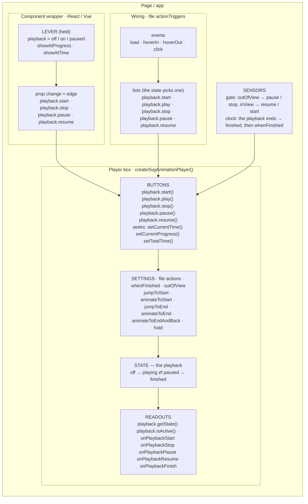
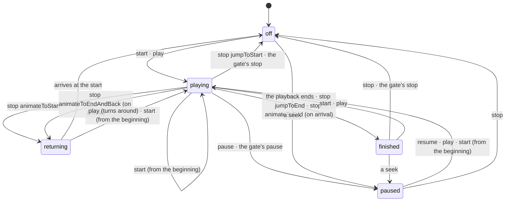

# Animation state — the playback model

Status: **implemented** — schema 1.24 (the model, 2026-11-11), 1.25 (the words, 2026-11-12) and 1.26 (state words and move
words, 2026-11-13). The noun is **playback** ([animation-state.playback-noun.md](./animation-state.playback-noun.md)), the
handle is one object `player.playback.*` and the file names each built-in action `"playback.start"` …
([animation-state.playback-namespace.md](./animation-state.playback-namespace.md)); 1.26 made `start` always play from the
start, added `play` (start or carry on), kept the state apart from the picture (`whenFinished`), let the gate press the real
buttons and turned `jumpToStart()` / `jumpToEnd()` / `playOnce()` into seeks and a recipe
([animation-state.feedback.2026-11-12.md](./animation-state.feedback.2026-11-12.md)). 1.24 spelt the noun "run" (§9). More cases, scroll
included, are in §3.1–3.4; the options for named parts and several animations are in §7. The
library survey is in [animation-state.survey.2026-11-09.md](./animation-state.survey.2026-11-09.md). Refines layer 2 of
[playback-layers.md](./playback-layers.md#layer-2--states-and-rules).

## 1. Terms and concepts

| Term | What it is | In the code |
|---|---|---|
| **Player box** | one instance of `createSvgAnimationPlayer()`: the animation, its clock, its state machine and its **imperative function controls** (buttons) | `PxAnimationPlayerApi` |
| **Button** | a momentary control on the box, pressed by code or by a rule: an act, named by a verb (+ the noun it acts on) — `playback.start()` `playback.play()` `playback.stop()` `playback.pause()` `playback.resume()` | `player.playback`, `PxPlayExecutor` |
| **Seek** | moves the playhead: `setCurrentTime()` · `setCurrentProgress()` · `setTotalTime()`. While `playing` it keeps playing from there; in any other state the playback becomes `paused` at that frame (1.26). A seek reports nothing | `PxPlayExecutor.seek` |
| **Component wrapper** | the React / Vue box around the player box: declarative, so it has **state controls** (levers), not buttons; a prop change is an edge that presses a button | `SvgAnimationPlayer`, `resolveDeclarativePlayback` |
| **Lever** | a held position (a prop), named by its noun and its positions; each lever has exactly two buttons — its edges | props |
| **Driver** | what makes the animation play: the file's wiring (the default, no prop; `actionTriggers` gives other wiring, `disableActionTriggers` switches it off so code drives), the lever (`playback`) or nothing (`showAtProgress` / `showAtTime` shows one frame, `showAsStatic` the picture as drawn). One driver family per element | `PxControlProps` union, `resolveControlMode` |
| **Playback** | one instance (session) of the animation being in effect — what lever 1 switches on. It begins with `playback.start` (always from the start) or `playback.play` (from rest), and lasts until `playback.stop` retires it. While it exists its state is **`playing` · `paused` · `finished`**. A playback contains the iterations: a loop's playback is endless, `getTotalDuration()` is one playback's length | `PxPlayExecutor`, `getTotalDuration()` |
| **Off** | no playback; the rest pose shows (`whenIdle: static` / `firstFrame`) | `PxPlaybackState.off` |
| **Freeze** (lever 2) | the clock stopped inside a playback, pose kept, resumable — `playback.pause` / `playback.resume`; state `paused` | executor `paused` flag |
| **Finished** | a playback that reached its end by playing, or a stop that went to the end. The state stays `finished` whatever the picture then shows (`whenFinished`, 1.26); `playback.stop` acts on it, `playback.start` is a fresh playback | `PxPlaybackState.finished`, executor `finished` flag |
| **The end** (of the pass) | always a compound word — `jumpToEnd` · `animateToEnd` · `animateToEndAndBack` · `whenFinished` — never a bare verb; the end of the CURRENT pass | `onNaturalFinish` |
| **State word** | changes the playback state: `start` · `play` · `stop` · `pause` · `resume` (and the gate's `stop`) | the buttons |
| **Move word** (setting) | changes only the picture — where it goes and how: `jumpToStart` · `animateToStart` · `jumpToEnd` · `animateToEnd` · `animateToEndAndBack` · `hold` | `actions["playback.stop"]`, `whenFinished` |
| **Wiring** | the file's rule for which page event presses which button: `actionTriggers.<button>: events` (`playback.start` · `playback.play` · `playback.stop` · `playback.pause` · `playback.resume`); the current state picks the list (the state rule, §4) | `timeline.actionTriggers`, `triggerActionFor` |
| **Sensor** | what the box notices by itself and answers by rule: the visibility gate (`inView` / `outOfView`), the clock reaching the end (`whenFinished`), pointer events (fed to the wiring). A sensor's rule is a setting, not a button | `PxVisibilityGate`, `onNaturalFinish` |
| **The gate's buttons** | out of view the gate presses the real `pause` (or a hard `stop` — at once, never animated); back in view it undoes only what it did (`resume`, or `start`). A playback the page paused stays paused (1.26; until 1.25 the gate held the engine's clock without telling) | `leaveView` / `returnToView` |
| **Return leg** | the picture moving back to the rest pose — after `playback.stop: animateToStart` / `animateToEndAndBack` (state **`returning`**, no playback) or after `whenFinished: animateToStart` (state stays `finished`). `playback.play()` turns it around; `playback.start()` plays from the beginning | executor `reversed` |
| **Readout** | what the box reports: `playback.getState()` (`off` · `playing` · `paused` · `finished` · `returning` · `destroyed`), `playback.isActive()` (the playback exists), `isPlaying()` (= `playing`); callbacks `onPlaybackStart` `onPlaybackStop` `onPlaybackPause` `onPlaybackResume` `onPlaybackFinish`; registry events | `getState()`, callbacks, `PxAnimatorRegistry` |
| **Request vs result** | a lever asks (`playback="on"`), a readout answers (`playing` or `finished`); the words are kept apart on purpose | — |

Four kinds of word, one grammar each:

| Kind | Holds / does | Named by | Example |
|---|---|---|---|
| **lever** | a position, held | the lever's noun + its positions | `playback="paused"` |
| **button** | an act that changes the state, momentary | a verb + the noun it acts on | `playback.start`, `playback.pause` |
| **setting** | how the picture moves | a move word — where + how | `animateToStart` |
| **readout** | what it is | a state word | `paused`, `finished` |

A lever has exactly two buttons (its edges); the file names buttons, never levers (a file cannot hold a position; the
page can); sensors press buttons by rule, and their rules (`whenFinished`, `actions.outOfView`) are settings, not buttons.

## 2. The machinery as boxes




| Box | What it is | Its controls |
|---|---|---|
| **Player box** | one instance of `createSvgAnimationPlayer()` | buttons `playback.start()` `playback.play()` `playback.stop()` `playback.pause()` `playback.resume()`; the seeks |
| **Settings** | how a press moves the picture | `actions["playback.stop"]`; sensor rules `whenFinished` · `actions.outOfView`. The start has none: always from the start |
| **Wiring** | which page event presses which button | `actionTriggers["playback.start"]` · `playback.play` · `playback.stop` · `playback.pause` · `playback.resume` over `load` · `hoverIn` · `hoverOut` · `click`; the current state picks the list |
| **Component wrapper** | React / Vue around the box — at most one driver prop | none (the file's wiring) · `actionTriggers` (other wiring) · `disableActionTriggers` (no wiring: code) · `playback` (the lever) · `showAtProgress` / `showAtTime` (one frame) · `showAsStatic` (the picture as drawn) |
| **Sensors** | what the box notices and answers by rule | the visibility gate (`inView` / `outOfView` — the real pause or stop), the clock reaching the end, pointer events (fed to the wiring) |
| **Inside** | the playback's state machine | `off` · `playing` · `paused` · `finished` · `returning` (· `destroyed`) |
| **Readouts** | what the box reports | `playback.getState()` `playback.isActive()` `isPlaying()`; `onReady` `onPlaybackStart` `onPlaybackStop` `onPlaybackPause` `onPlaybackResume` `onPlaybackFinish` `onDestroy`; registry events |

## 3. The model

```js
// WEB PLAYER — plays the way the file was saved: its actionTriggers drive it
const player = createSvgAnimationPlayer({
  container, document: 'lid.svga.json',     // a URL, or the document itself
                                            // disableActionTriggers: true → only the calls below
  onPlaybackStart() {}, onPlaybackStop() {}, onPlaybackPause() {}, onPlaybackResume() {}, onPlaybackFinish() {},
});

// lever 1 — the playback
player.playback.start();    // a playback from the start — in every state
player.playback.play();     // start or carry on: resumes a pause, turns a return around, nothing while playing
player.playback.stop();     // → off per actions["playback.stop"] (jumpToStart · animateToStart · …ToEnd → finished)
// lever 2 — the freeze (only inside a playback)
player.playback.pause();
player.playback.resume();
// seeks — while playing it keeps playing; otherwise paused at that frame
player.playback.setCurrentProgress(1.2);   // progress counts iterations: 20 % into the second
player.playback.setTotalTime(0);
// readouts
player.playback.getState();    // 'off' | 'playing' | 'paused' | 'finished' | 'returning'
player.playback.isActive();    // playing · paused · finished

// one pass of a looping file: timelineOptions: { iterations: 1 } + playback.start() (playOnce() until 1.25)
```

```jsx
// REACT / VUE — one driver family per element
<SvgAnimationPlayer document={doc} />                                                      // the file's triggers (no prop)
<SvgAnimationPlayer document={doc} playback={hovered ? (frozen ? "paused" : "on") : "off"} />  // the lever
<SvgAnimationPlayer document={doc} showAtProgress={0.5} />                                 // one frame, nothing plays
<SvgAnimationPlayer document={doc} showAsStatic />                                         // the picture as drawn, calls ignored
// prop diff → button:  off→on playback.start() · on→paused playback.pause() · paused→on playback.resume() · →off playback.stop()
// a mount with playback="off" presses nothing; a mount with "paused" = playback.start() + playback.pause()
```

```json
// SCHEMA — lists name the buttons; actions say how the stop moves the picture
"timeline": {
  "actionTriggers": { "playback.start": "load" },                                         // autoplay
  "actionTriggers": { "playback.play": "hoverIn", "playback.stop": "hoverOut" },          // the lid
  "actionTriggers": { "playback.play": "click", "playback.pause": "click" },              // a click play / pause
  "actionTriggers": { "playback.start": "click", "playback.stop": "click" },               // a click toggle that restarts
  "actions": { "playback.stop": "animateToEndAndBack", "outOfView": "stop" },
  "whenFinished": "hold"
}
```

| Where | Words |
|---|---|
| Props | `playback="off" \| "on" \| "paused"` beside `actionTriggers`, `disableActionTriggers`, `showAtProgress`, `showAtTime`, `showAsStatic` — one driver family at a time (the TypeScript union stays); none of them: the file's triggers |
| Handle | everything on `player.playback`: `start()` `play()` `stop()` `pause()` `resume()`; the seeks; `getState()` `isActive()` `isPlaying()`; both clocks and the speed |
| File | `actionTriggers: { "playback.start", "playback.play", "playback.stop", "playback.pause", "playback.resume" }` (always quoted); `actions: { "playback.stop": jumpToStart · animateToStart · jumpToEnd · animateToEnd · animateToEndAndBack, outOfView: pause · continue · stop }`; `whenFinished: hold · jumpToStart · animateToStart` |
| Readouts | `playback.getState()` → `off` · `playing` · `paused` · `finished` · `returning` (the request says `on`, the result says `playing` or `finished`); `playback.isActive()`; callbacks `onPlaybackStart` `onPlaybackStop` `onPlaybackPause` `onPlaybackResume` `onPlaybackFinish` |
| Editor | Start playback on · Play on · Stop playback on · Pause playback on · Resume playback on; Stop playback · When finished · Out-of-View Action |

Rules, written once:

- `playback` off → on presses `playback.start()`, on → paused `playback.pause()`, paused → on `playback.resume()`, anything → off
  `playback.stop()` (which clears the freeze).
- `playback.start()` always plays from the start — in every state; the delay is waited again. `playback.play()` carries on
  instead: a pause resumes, a return turns around, nothing while playing, otherwise a start.
- `playback.stop()` retires per `actions["playback.stop"]`; a stop to the end rests `finished`, and `whenFinished` applies.
- The state stays `finished` after the end whatever `whenFinished` shows — only the picture moves.
- A seek while `playing` keeps playing; in any other state the playback becomes `paused` there.

What 1.24 fixed (read from the source on 2026-11-10, schema 1.23):

1. The levers' edges had no buttons of their own — both edges of `play` and the OFF edge of `pause` landed on `play()`,
   which decided by state.
2. `play` was a lever named like a button and like the readout `playing`.
3. `pause` was a lever AND a button with one spelling.
4. `finish` sat in `actions` beside the buttons, but nobody presses it — the clock's rule.
5. One act, five spellings across the layers (`start` · `play()` · `PxTriggerAction.play` · gate `start` · `onPlay`).
6. Two booleans allowed an invalid pair (`play={false} pause={true}`); one three-position lever cannot.

What 1.26 fixed (the owner's review, 2026-11-12):

1. `start` meant three things by a setting in the file — now it means one, and `play` names the other.
2. The state followed the picture: `atEnd: jumpToStart` made a finished playback read `off`.
3. The gate held the clock in secret: the state said `playing` off screen, and no callback told the page.
4. `jumpToStart()` / `jumpToEnd()` were a stop and a finish in disguise, `playOnce()` a second start.
5. "Finish the pass, then go back" could not be written without changing what the natural end does.

Precedent for the quartet: `MediaRecorder` — `start()` `pause()` `resume()` `stop()`, `state: inactive · recording ·
paused`, events `start` `pause` `resume` `stop`. For the two levers: Three.js `AnimationAction.enabled` + `paused`
(`isRunning()` derived; `clampWhenFinished` = our `hold`). For `play` as start-or-carry-on: every media element.

Marks in §3.1–3.4 and §7: ✅ works today · 🧪 in the player, but marked "in development" · 💡 a sketch, not implemented.

### 3.1 More cases — the web player

✅ All of these work in 1.26.

```js
// A play / pause button
button.onclick = () => player.playback.getState() === 'playing' ? player.playback.pause() : player.playback.play();

// A replay button — from the start, in every state
replay.onclick = () => player.playback.start();

// The lid from code: opens on enter, closes backwards on leave (the file's own triggers off)
const lid = createSvgAnimationPlayer({ container, document: lidDoc, disableActionTriggers: true,
  actions: { 'playback.stop': 'animateToStart' } });
card.onpointerenter = () => lid.playback.play();     // play, not start: it turns a closing lid around
card.onpointerleave = () => lid.playback.stop();

// A spinner: loops while saving, then finishes its turn and rests
const spinner = createSvgAnimationPlayer({ container, document: spinnerDoc, disableActionTriggers: true,
  timelineOptions: { iterations: 'infinite' }, actions: { 'playback.stop': 'animateToEnd' } });
spinner.playback.start();
await save();
spinner.playback.stop();                             // the current turn plays out → finished

// A slider: a seek outside `playing` leaves it paused on that frame
slider.oninput = () => player.playback.setCurrentProgress(slider.valueAsNumber);   // 0..1 = one pass
playButton.onclick = () => player.playback.play();                                 // carries on from there

// One pass of a looping file
createSvgAnimationPlayer({ container, document: loopDoc, timelineOptions: { iterations: 1 } }).playback.start();

// A chain: B starts when A has played to its end
const a = createSvgAnimationPlayer({ container: elA, document: docA, onPlaybackFinish: () => b.playback.start() });

// Twice as fast
player.playback.setSpeed(2);

// The page gives the triggers (they replace the file's)
createSvgAnimationPlayer({ container, document: doc,
  actionTriggers: { 'playback.play': 'click', 'playback.pause': 'click' } });

// A still — the picture as drawn; playback calls are ignored with a warning (PX1506)
createSvgAnimationPlayer({ container, document: doc, showAsStatic: true });
```

```html
<!-- No code of your own: a tag, and the file's own triggers -->
<div data-px-document="/ball.json"></div>
<script>Pixodesk.SvgAnimator.createSvgAnimationPlayersFromPage();</script>
```

### 3.2 More cases — React and Vue

✅ All of these work in 1.26.

```jsx
// Plays while a flag holds
<SvgAnimationPlayer document={spinner} playback={saving ? 'on' : 'off'} timelineOptions={{ iterations: 'infinite' }} />

// A play / pause button from state
<SvgAnimationPlayer document={doc} playback={playing ? 'on' : 'paused'} />
<button onClick={() => setPlaying(!playing)}>{playing ? 'Pause' : 'Play'}</button>

// The lid: the lever, and a stop that plays backwards (a hover back starts over — off → on is start)
<SvgAnimationPlayer document={lid} playback={hovered ? 'on' : 'off'} actions={{ 'playback.stop': 'animateToStart' }} />

// Buttons through the ref — the file's triggers off, so only the code plays it
const playerRef = useRef(null);
<SvgAnimationPlayer document={bell} disableActionTriggers playerRef={playerRef} />
<button onClick={() => playerRef.current.playback.start()}>Ring</button>

// Know when it has played
<SvgAnimationPlayer document={intro} playback="on" onPlaybackFinish={() => setIntroDone(true)} />

// One frame from app state: a progress ring, a rating, a step
<SvgAnimationPlayer document={ring} showAtProgress={uploaded / total} />

// The file's triggers, corrected by the page
<SvgAnimationPlayer document={doc} timelineOptions={{ iterations: 1, whenFinished: 'jumpToStart' }} />
<SvgAnimationPlayer document={doc} actionTriggers={{ 'playback.start': 'click' }} />   // instead of the file's
```

```vue
<!-- Vue: the same props; the callbacks are events -->
<SvgAnimationPlayer :document="doc" :playback="hovered ? 'on' : 'off'" @playback-finish="onDone" />
```

### 3.3 More cases — the file

✅ All of these work in 1.26. The first eight are the editor's presets (its three hover presets also write
`"actions": { "outOfView": "continue" }`).

```json
// Loop when seen
"timeline": { "iterations": "infinite", "actionTriggers": { "playback.start": "load" } }

// Play once when seen, hold the last frame
"timeline": { "actionTriggers": { "playback.start": "load" } }

// Replay each time seen
"timeline": { "actionTriggers": { "playback.start": "load" }, "actions": { "outOfView": "stop" } }

// Run always, even off screen
"timeline": { "iterations": "infinite", "actionTriggers": { "playback.start": "load" }, "actions": { "outOfView": "continue" } }

// Hover: play / pause
"timeline": { "iterations": "infinite", "actionTriggers": { "playback.play": "hoverIn", "playback.pause": "hoverOut" } }

// Hover: there and back, by itself
"timeline": { "actionTriggers": { "playback.play": "hoverIn" }, "whenFinished": "animateToStart" }

// Hover: one nudge — every hover plays it from the start
"timeline": { "actionTriggers": { "playback.start": "hoverIn" }, "whenFinished": "jumpToStart" }

// Click: play / pause
"timeline": { "iterations": "infinite", "actionTriggers": { "playback.play": "click", "playback.pause": "click" } }

// The lid: opens while hovered, closes backwards
"timeline": { "actionTriggers": { "playback.play": "hoverIn", "playback.stop": "hoverOut" }, "actions": { "playback.stop": "animateToStart" } }

// A loop that ends politely: hover out finishes the pass, then goes back
"timeline": { "iterations": "infinite", "actionTriggers": { "playback.play": "hoverIn", "playback.stop": "hoverOut" },
              "actions": { "playback.stop": "animateToEndAndBack" } }

// Starts half a second after it is fully in view
"timeline": { "delay": 500, "inViewThreshold": 1, "actionTriggers": { "playback.start": "load" } }

// Manual: no triggers — the page's code or the `playback` prop plays it
"timeline": { "iterations": "infinite" }
```

### 3.4 Cases — scroll

Scroll can drive an animation in three ways. The contract of the second one is §6.

| Way | What scrolling does | Status |
|---|---|---|
| **A. Play when seen** | starts the clock; out of view it pauses or stops | ✅ |
| **B. The file follows the scroll** | `timeline.type: "view"` / `"scroll"` — the scroll position is the playhead | 🧪 player and SVG + JS export; the editor's picker is behind the experimental switch |
| **C. The page follows the scroll** | the page measures, then seeks | ✅ |

**A. Play when seen** ✅ — a clock timeline behind the visibility gate.

```json
// Plays when half of it has been on screen for 150 ms (the defaults, written out); pauses when scrolled away
"timeline": { "actionTriggers": { "playback.start": "load" }, "inViewThreshold": 0.5, "inViewDebounce": 150 }

// Plays again on every entry
"timeline": { "actionTriggers": { "playback.start": "load" }, "actions": { "outOfView": "stop" } }
```

**B. The file follows the scroll** 🧪 — read from the source, not run in a browser in this pass.

```json
// First frame as it enters the viewport, last frame as it leaves
"timeline": { "type": "view" }

// Draws itself while entering: done once it is fully in view
"timeline": { "type": "view", "range": { "start": { "phase": "entry", "fraction": 0 }, "end": { "phase": "entry", "fraction": 1 } } }

// A reading-progress bar: top of the page → bottom of the page
"timeline": { "type": "scroll", "source": "root" }

// Follows a horizontal scroller (the nearest one)
"timeline": { "type": "scroll", "axis": "x" }

// Scrollytelling: held in the centre for three screens while the section scrolls past, with a soft catch-up
"timeline": { "type": "view", "subject": "parent", "pin": { "align": "center", "distance": 3 }, "smoothing": 150 }

// Another element's journey drives it
"timeline": { "type": "view", "subject": "#chapter-2" }

// Only a window of the keyframes, twice across the range
"timeline": { "type": "view", "inTime": 1000, "outTime": 3000, "iterations": 2 }
```

```js
// A scroll-driven file: create it, and that is all — no driver, no calls
const chart = createSvgAnimationPlayer({ container, document: '/chart.json' });

// A clock file made scroll-driven by the page (the file's clock-only keys are dropped, with a warning)
createSvgAnimationPlayer({ container, document: ballDoc,
  timelineOptions: { type: 'view', subject: 'parent', pin: true } });

chart.playback.getCurrentProgress();    // readouts work: where the scroll has put the playhead
chart.playback.start();                 // buttons do nothing, and warn (PX1505)
```

```jsx
<SvgAnimationPlayer document={chart} />                                                  // a scroll-driven file
<SvgAnimationPlayer document={ball} timelineOptions={{ type: 'view', subject: 'parent', pin: true }} />   // made so by the page
```

**C. The page follows the scroll** ✅ — a clock file, the page's own measuring, a seek.

```js
// Any scroll maths → a seek. The state reads `paused`.
addEventListener('scroll', () => {
  const max = document.documentElement.scrollHeight - innerHeight;
  player.playback.setCurrentProgress(scrollY / max);
}, { passive: true });
```

```jsx
// React, with any scroll hook (here Motion's)
const { scrollYProgress } = useScroll({ target: sectionRef });
const [progress, setProgress] = useState(0);
useMotionValueEvent(scrollYProgress, 'change', setProgress);
<SvgAnimationPlayer document={chart} showAtProgress={progress} />
```

**What scroll most likely gets next** 💡 — sketches, none of it exists.

```js
player.playback.getState();                          // 'scrubbing' — one state on every engine (today it depends on the engine)
createSvgAnimationPlayer({ container, document: '/chart.json',
  onScrollProgress(progress) {},                     // the playhead moved with the scroll
  onScrollRangeEnter() {}, onScrollRangeLeave() {},  // the range began / ended (either direction)
});
```

```jsx
// A prop of its own, instead of a timeline type inside timelineOptions; the subject as a ref
<SvgAnimationPlayer document={ball} scroll={{ type: 'view', subject: sectionRef, pin: true }} onScrollProgress={setProgress} />
```

```html
<!-- The tag: scroll settings without code -->
<div data-px-document="/ball.json" data-px-scroll="view" data-px-scroll-pin></div>
```

```json
// Stops along the way: when the scrolling ends, the playhead settles on the nearest one
"timeline": { "type": "view", "snap": [0, 0.5, 1] }

// Scroll as an input instead of a timeline type: the clock model stays, and the scroll position picks the part (§7)
"timeline": { "segments": { "intro": { "outTime": 1000 }, "chart": { "inTime": 1000, "outTime": 3000 } },
              "scroll": { "subject": "parent", "enter": [{ "at": 0, "segment": "intro" }, { "at": 0.4, "segment": "chart" }] } }
```

## 4. Inside the box — the playback's state machine



| Point | Rule |
|---|---|
| The state rule — which list an event is read from | `playing`: pause · stop · start; `paused`: resume · play · stop · start; `off` and `returning`: start · play; `finished`: stop · start · play while it holds the last frame, otherwise start · play · stop. The first list that names the event wins |
| Arrival at the end | the natural end or a stop to the end: the playback is `finished`, then `whenFinished` moves the picture (hold · jumpToStart · animateToStart); `onPlaybackFinish` only for the natural end |
| "End" | the end of the CURRENT pass; a stop that finishes the pass reports `onPlaybackStop` on arrival |
| `paused` into `finished` | cleared: `start`, `play`, `stop` and the engine's end set the freeze off |
| The gate | out of view: `pause` pauses a playing playback; `stop` stops a playing or finished one at once (never animated, whatever the stop action says). In view: it resumes, or starts again — only what it did itself |
| Seeks | `playing` keeps playing; otherwise `paused` at that frame. Nothing is reported |
| Scroll / view timelines | §6 (the contract), §3.4 (cases) |

## 5. Why these words

What each verb means elsewhere, in this grammar (GO = off → a playback · CONTINUE = unfreeze · FREEZE · RETIRE = to the
rest pose and stay · HALT = clock stopped, pose kept, no resume). Full matrix: the survey file.

| Word | Who | Meaning there |
|---|---|---|
| `play` | WAAPI, `<video>`, YouTube, lottie-web, dotLottie, Rive, GSAP, anime, Motion, SVGator, Godot | GO or CONTINUE by state — always "from the current position"; never a lever. Ours since 1.26: `playback.play()`, the convenience, beside `start` (which always goes from the start) |
| `pause` | everyone but Spine / Unity's Animator (`timeScale` / `speed = 0`) | FREEZE, resumable — our `playback.pause()` |
| `resume` | GSAP, anime, MediaRecorder | CONTINUE — where it differs from `play` |
| `stop` | lottie-web, dotLottie, SVGator, Three.js, Godot, Unity, Rive, YouTube, Motion | four different things: RETIRE to the first frame (lottie-web, dotLottie, SVGator, Three.js, Godot); HALT keeping the pose (Godot `stop(true)`, Motion — terminal); UNLOAD (YouTube); halt the state machine (Rive) — hence `playback.stop` is pinned by the move word beside it |
| `start` / `stop` as a pair | MediaRecorder (`stop()` = the session is over, a new `start()` begins another), Android `MediaPlayer`, Unity `Animation` | a session's bracket — ours: `start` always begins a new one |
| `cancel` | WAAPI, Motion, anime | RETIRE (WAAPI → `idle`, Motion → initial) or HALT + dispose (anime) |
| `finish` · `complete` | WAAPI, anime, Motion | jump TO THE END, end callbacks run — ours: a seek to the end shows the frame; `onPlaybackFinish` reports a natural end |
| `restart` | GSAP, anime, SVGator | a fresh playback from the start — ours is `playback.start` |
| `reset` | Three.js, anime, Rive | levers to default + time 0 (Three.js), pause + time 0 (anime), rebuild (Rive) — ours is `playback.stop` (`jumpToStart`) |
| `freeze` / `unfreeze` | dotLottie (Rive `stopRendering`) | the render loop off / on — our gate presses the real `pause` instead (1.26) |
| `enabled` · `active` | Three.js, Unity, Godot `active` | the switch lever as a PROPERTY — never a method; our `playback` |
| `idle` · `inactive` · `unstarted` | WAAPI, MediaRecorder, YouTube | the not-playing state — our `off` |

Three.js in code, the two-lever precedent (`src/animation/AnimationAction.js`, verified):

```js
action.enabled = false;  // switch off: no impact, rest pose shows; time KEPT — re-enable continues
action.paused  = true;   // time stands still
action.isRunning();      // enabled && !paused && timeScale !== 0 && scheduled — derived, never set
if ( this.clampWhenFinished ) this.paused = true;   // the end of a one-shot: = our hold
else this.enabled = false;                          // = our whenFinished: jumpToStart
```

## 6. Scroll and view timelines

On a scroll or view timeline (`timeline.type: "scroll" | "view"`) the scroll position owns the playhead. What that means
for the model, read from the source on 2026-11-13 (not yet checked in a browser). How to set one up, and what it most
likely gets next: §3.4.

| Part | On a scroll / view timeline |
|---|---|
| Buttons | `start()` `play()` `stop()` `pause()` `resume()` `setSpeed()` `setDurationAtSpeed()` do nothing and warn (PX1505 `scrollOwnsPlayhead`) |
| Seeks | apply until the next scroll moves the playhead again |
| Wiring | inert — the file has no `actionTriggers` there, and a block that slips in is warned about and skipped |
| Settings | the scroll member of the schema has no `actions`, `whenFinished`, `whenIdle`, `playbackSpeed`, `delay` or gate numbers; it keeps `inTime` / `outTime`, a finite `iterations`, `engine`, `frameRate` and its own scroll keys (`axis`, `source`, `subject`, `smoothing`, `pin`, `range`) |
| Sensors | no visibility gate; the clock is the scroll position |
| Readout `getState()` | depends on the engine today: with the browser's own scroll timeline (`engine: auto` / `native` where supported) the animations run, so it reads `playing` — and `finished` from the first time the range end is reached; with the player's own measuring it reads `off` (or `paused` after a page seek) |
| Callbacks | `onPlaybackFinish` can fire when the browser's scroll timeline reaches the end of its range; the other playback callbacks never fire |
| Editor | the Timeline picker (Time · Scroll) shows only in experimental builds, or for a file that is already scroll-driven |

Open, for a later step: whether a scroll timeline should read one state of its own (for example `scrubbing`) on every
engine, and whether `onPlaybackFinish` belongs to it at all; whether scroll stays a timeline type or becomes an input that
drives progress (layer 4 of [playback-layers.md](./playback-layers.md)), which decides how it combines with segments.

## 7. Several parts, several animations — options

💡 Nothing in this section is implemented, except 7.1. Today a file has one timeline and one window (`inTime` – `outTime`).
Background: item 13 of [animation-state.feedback.2026-11-12.md](./animation-state.feedback.2026-11-12.md) (Lottie markers,
dotLottie, Rive) and layers 2–4 of [playback-layers.md](./playback-layers.md).

The example in every option: one button animation with three parts — `intro` (0–1 s, once), `loop` (1–3.5 s, repeats),
`success` (3.5–5 s, once).

### 7.1 Today ✅ — the page does it

```jsx
// Two files, sequenced by the page
{introDone
  ? <SvgAnimationPlayer key="loop" document={loop} playback="on" timelineOptions={{ iterations: 'infinite' }} />
  : <SvgAnimationPlayer key="intro" document={intro} playback="on" onPlaybackFinish={() => setIntroDone(true)} />}
```

```js
// One file, one window per player
createSvgAnimationPlayer({ container, document: doc, timelineOptions: { inTime: 1000, outTime: 3500, iterations: 'infinite' } });
```

### 7.2 Option A — markers: the file names the parts, the page plays them

Like Lottie markers with `playSegments`. The file holds names only.

```json
"timeline": {
  "outTime": 5000,
  "segments": {
    "intro":   { "inTime": 0,    "outTime": 1000 },
    "loop":    { "inTime": 1000, "outTime": 3500 },
    "success": { "inTime": 3500, "outTime": 5000 }
  }
}
```

```js
player.playback.start('intro');                               // plays that part; `finished` at its end
player.playback.start('loop', { iterations: 'infinite' });
player.playback.getSegment();                                 // 'loop'
player.playback.getSegments();                                // ['intro', 'loop', 'success']

// intro → loop stays the page's job
const player = createSvgAnimationPlayer({ container, document: doc,
  onPlaybackFinish({ segment }) { if (segment === 'intro') player.playback.start('loop', { iterations: 'infinite' }); } });
```

```jsx
<SvgAnimationPlayer document={doc} playback="on" segment={saved ? 'success' : 'loop'} />
```

### 7.3 Option B — segments: each part has its settings and says what comes next

Option A, plus the timeline's own keys per segment, `next`, and buttons the file can wire.

```json
"timeline": {
  "segments": {
    "intro":   { "inTime": 0,    "outTime": 1000, "next": "loop" },
    "loop":    { "inTime": 1000, "outTime": 3500, "iterations": "infinite" },
    "success": { "inTime": 3500, "outTime": 5000, "whenFinished": "hold" }
  },
  "actionTriggers": { "playback.start": "load", "segment.set": { "success": "click" } },   // or "segment.next": "click"
  "actions": { "segment.set": "animateToEnd" }    // how a switch gets there: jump · animateToEnd · animateToStart
}
```

```js
player.segment.set('success');             // switches the way actions["segment.set"] says
player.segment.set('success', 'jump');     // or the call says how
player.segment.next();
player.segment.get();                      // 'loop'
player.segment.getAll();                   // ['intro', 'loop', 'success']

createSvgAnimationPlayer({ container, document: doc,
  onSegmentChange(segment, previous) {},   // intro → loop, loop → success
  onPlaybackFinish() {} });                // a segment with no `next` played to its end
```

```jsx
// `segment` is a lever, like `playback`: a held position; a change presses segment.set
<SvgAnimationPlayer document={doc} playback="on" segment={saved ? 'success' : 'loop'} onSegmentChange={setPart} />
```

### 7.4 Option C — states: a state machine in the file

Like Rive and dotLottie state machines. Option B, plus inputs the app sets and rules that move between states.

```json
"timeline": {
  "segments": { "idle": { "outTime": 2000 }, "walk": { "inTime": 2000, "outTime": 3000 }, "jump": { "inTime": 3000, "outTime": 3600 } },
  "inputs":   { "speed": 0, "jump": "event" },
  "states": {
    "idle": { "segment": "idle", "iterations": "infinite", "transitions": [{ "to": "walk", "when": { "speed": { "above": 0 } } }] },
    "walk": { "segment": "walk", "iterations": "infinite", "transitions": [{ "to": "idle", "when": { "speed": 0 } },
                                                                           { "to": "jump", "on": "jump" }] },
    "jump": { "segment": "jump", "transitions": [{ "to": "walk", "on": "finished" }] }
  },
  "actionTriggers": { "input.jump": "click" }
}
```

```js
player.inputs.set('speed', 1);     // idle → walk
player.inputs.fire('jump');        // walk → jump → walk
player.state.get();                // 'walk'
// onStateChange(state, previous)
```

```jsx
<SvgAnimationPlayer document={hero} inputs={{ speed }} onStateChange={setState} playerRef={playerRef} />
<button onClick={() => playerRef.current.inputs.fire('jump')}>Jump</button>
```

### 7.5 Option D — several timelines in one file

Like Rive's animations and layers. Each timeline has its own clock, triggers and playback, and they can run at once on
different elements.

```json
"animator": {
  "timelines": {
    "blink": { "iterations": "infinite", "actionTriggers": { "playback.start": "load" } },
    "wave":  { "actionTriggers": { "playback.start": "click" }, "whenFinished": "animateToStart" }
  },
  "bindings": [
    { "target": "#eyes", "animateWith": ["blinkKeys"], "timeline": "blink" },
    { "target": "#arm",  "animateWith": ["waveKeys"],  "timeline": "wave" }
  ]
}
```

```js
player.timeline('wave').playback.start();     // every timeline has the same handle as today
player.timeline('blink').playback.pause();
player.playback.start();                      // the first timeline — today's calls keep working
```

```jsx
<SvgAnimationPlayer document={mascot} playback={{ blink: 'on', wave: waving ? 'on' : 'off' }} />
```

### 7.6 Side by side

| | A markers | B segments | C states | D timelines |
|---|---|---|---|---|
| Play a named part from code | ✓ | ✓ | ✓ | ✓ |
| Intro → loop without page code | — | ✓ | ✓ | — |
| The file wires hover / click to a part | — | ✓ | ✓ | ✓ |
| Conditions, values from the app | — | — | ✓ | — |
| Two animations at once | — | — | — | ✓ |
| Blend from one into another | — | — | — | — |
| Who decides what plays | the page | the file, simple rules | the file, rules and inputs | the file, per timeline |
| New in the schema | `segments` (names) | + settings, `next`, `segment.*` | + `inputs`, `states` | `timelines`, a binding's `timeline` |
| New in the player | a window that changes while playing | + "segment ended", the switch rule | + evaluating rules | one executor per timeline |
| New in the editor | markers on the ruler | + a panel per segment | a state graph | a timeline switcher |
| Closest to | Lottie markers | dotLottie segments | Rive, dotLottie state machines | Rive animations and layers |

A, B and C build on each other: each is the one before plus one block, so a file written for A stays valid in B and C.
D is separate and combines with any of them. None of them blends two animations; that needs a different engine.

What today's words would mean once a file has segments:

| Word | With segments |
|---|---|
| `playback.start()` | the current segment from its start; `start('name')` a named one |
| `whenFinished` · `iterations` · `playbackSpeed` | per segment, the timeline's value as the default |
| `actions["playback.stop"]` | moves inside the current segment: its start, its end |
| `onPlaybackFinish` | a segment with no `next` ended; `onSegmentChange` reports the steps before it |
| `getDuration()` · progress | the current segment's length; progress counts its iterations |
| the visibility gate | unchanged |

**Suggestion:** B as the next schema step, released in two parts — first the names and `start('name')` (which is A), then
`next`, the per-segment settings and `segment.set`. C waits until a real file needs conditions. D only if two animations
at once becomes a real request.

## 8. Later — not in this step

- **Inputs (layer 2 + 4, the destination):** every lever and button becomes an input the file wires events to;
  `playback`'s positions are the built-in input. These names are those inputs, so this is a step, not a detour:
  ```json
  "timeline": { "state": { "playback": { "off": { "initial": true }, "playing": {}, "paused": {}, "finished": {} } }, "actionTriggers": { "playback.play": "hoverIn", "playback.stop": "hoverOut" }, "whenFinished": "hold" }
  ```
- **Segments, states, several timelines** — the options are §7.
- **The gate as a sensed lever** (`inView`), with its own rule words beside `outOfView`.
- **Pointer words:** `hoverIn` / `hoverOut` are web words; Rive, dotLottie and React Native say `pointerEnter` /
  `pointerExit`.

## 9. History

- 2026-11-09: the two switches as `timeline.state.animation.{play, pause}` + `playOn` / `playOff` names; then the
  three tiers (controls · animation state · moves) and the library survey.
- 2026-11-10: the boxes; `start` / `stop` vs `play` / `resume` / `pause` ambiguity; `enable` / `disable`, `activate` /
  `deactivate`, one-go-button `play()`, nouned spellings tried; the run as the lever's noun; `playRun` as the one driver
  prop with the `play` family mark; `endRun` weighed against `stopRun` and not taken.
- 2026-11-11: the noun changed — **playback**, not run (first flat: `startPlayback()` · `onPlaybackStart` · the `playback` prop ·
  `getPlaybackState()` · `playOnce()`); the reasoning is in [animation-state.playback-noun.md](./animation-state.playback-noun.md).
- 2026-11-12: one home — `player.playback.*` (`start()` · `getState()` · `getSpeed()` · `…AtSpeed`), no `play()` / `pause()`
  aliases, and dotted action names in the file (`"playback.start"`), folded into schema 1.25
  ([animation-state.playback-namespace.md](./animation-state.playback-namespace.md)).
- 2026-11-13: schema 1.26, the owner's review ([animation-state.feedback.2026-11-12.md](./animation-state.feedback.2026-11-12.md)):
  `start` always from the start and `play` beside it; `whenFinished` (was `atEnd`), the state stays `finished`; `outOfView:
  stop`, the gate presses the real buttons; `animateToEndAndBack`; `onPlaybackFinish`; one `document` option and
  `playerActionTriggers`; `jumpToStart()` / `jumpToEnd()` / `playOnce()` removed; progress counts iterations. This text lost
  its two working sections (the change ledger, the rejected ideas — both in git history) and gained §6.
- 2026-11-13, later: more cases for the player, the components and the file (§3.1–3.3); the scroll cases, with what
  scroll most likely gets next (§3.4); the options for named parts, states and several timelines (§7).
- 2026-11-13, owner decision: a player plays the way the file was saved — no prop = the file's `actionTriggers` drive it
  on every surface; `playerActionTriggers` removed (no alias); `actionTriggers` (a whole block instead of the file's;
  `null` / `{}` = none), `disableActionTriggers` (manual), `showAsStatic` (the picture as drawn, playback calls ignored,
  PX1506); `actions` replaces the file's block (it merged). §2 and §3 updated; the 1.26 entry above keeps its words.
